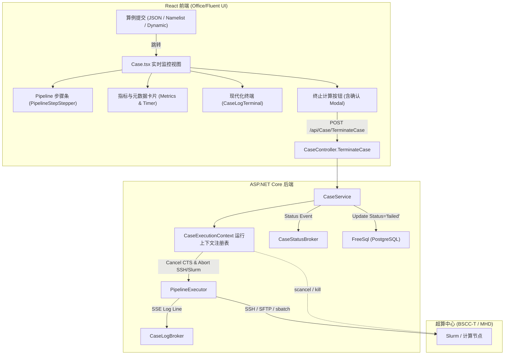

# 技术方案设计 (Design)

## 1. 架构与边界设计

本功能涉及后端计算生命周期管理与前端沉浸式监控界面的联动。



## 2. 后端设计与接口契约

### 2.1 任务执行上下文管理器 (CaseExecutionContext)
在 `CaseService` 中引入对活跃计算任务的登记管理：
```csharp
public class CaseExecutionContext
{
    public Guid UserId { get; set; }
    public Guid CaseId { get; set; }
    public CancellationTokenSource Cts { get; set; } = new();
    public SupercomputerDefinition? Supercomputer { get; set; }
    public SshClient? SshClient { get; set; }
    public SftpClient? SftpClient { get; set; }
    public SshCommand? ActiveSshCommand { get; set; }
    public string? RemoteWorkdir { get; set; }
    public DateTime StartTime { get; set; } = DateTime.UtcNow;
}
```
- `ConcurrentDictionary<Guid, CaseExecutionContext> _activeExecutions` 管理所有并发计算任务。
- 算例启动时调用 `RegisterExecution(context)`，无论成功、失败或异常，在 `finally` 块中调用 `UnregisterExecution(caseId)`。

### 2.2 `PipelineExecutor` 协作式取消与超算清理
- `Execute(...)` 方法接收 `CaseExecutionContext context` 及 `CancellationToken ct`。
- 在 `ExecuteSshExec` 中：
  - 注册 `ct.Register(() => { try { cmd.CancelAsync(); } catch {} })`。
  - 在捕捉到 `OperationCanceledException` 或 `ct.IsCancellationRequested` 时：
    - 若配置了 Slurm 超算（如 BSCC-T），通过备用 SSH 会话或断开前执行 `scancel` 清理该 workdir 下的作业，或 `pkill -f {workdir}`。
    - 优雅退出并由上层捕获。

### 2.3 终止 API 契约
- **端点**：`POST /api/Case/TerminateCase`
- **入参**：
  ```json
  {
    "id": "uuid-string-of-case"
  }
  ```
- **鉴权与校验**：
  - JWT 获取当前 `userId`，验证算例所有权（或管理员权限）。
  - 验证算例在数据库中是否处于 `running` 状态。
- **业务处理**：
  - 若在 `_activeExecutions` 中找到对应上下文，调用 `context.Cts.Cancel()`，并触发底层清理。
  - 推送日志：`_caseLogNotifier.NotifyLogLine(userId, id, "[Pipeline WARNING] 计算任务已被用户主动切断终止。")`。
  - 更新 DB：`Status = "failed"`，`UpdatedAt = DateTime.Now`。
  - 推送状态与完成事件：
    - `_caseStatusNotifier.NotifyStatusChanged(userId, id, caseSeqId, "failed")`
    - `_caseLogNotifier.NotifyLogCompleted(userId, id, isSuccess: false, errorMessage: "任务已由用户主动终止")`
- **响应**：`{ "success": true, "message": "算例计算已终止" }`

## 3. 前端设计与组件重构

### 3.1 实时监控视图整体布局 (`Case.tsx`)
重构 `isRunning || isFailed` 状态下的全屏渲染结构：
1. **顶部运行态 Ribbon 工具栏**：
   - 导航组：返回算例列表、刷新页面。
   - 操作组：终止计算（Danger 按钮，仅 running 态可用）、重新提交/以当前参数新建。
   - 终端工具组：自动滚屏切换、复制日志、下载 .out 文件、清屏。
2. **状态与指标卡片栏 (Header Summary Bar)**：
   - 算例序列号与备注标题。
   - 目标超算信息（如 `BSCC-T 北京超算` / `MHD@HUST 湖北超算`）。
   - 运行耗时秒表（动态刷新计时器：`00:02:34`）。
   - 状态徽章（呼吸灯运行中 / 失败 / 已终止 / 成功）。
3. **Pipeline 步骤条 (PipelineStepStepper)**：
   - 将算例生命周期映射为 5 个标准步骤：
     1. 参数转换 (`convert`)
     2. 目录创建与上传 (`upload`)
     3. 超算排队与计算 (`submit` / `jobxlpt`)
     4. 结果下载 (`download`)
     5. 后处理与归档 (`postprocess`)
   - 从 liveLogs 中智能解析当前最新阶段，高亮当前活跃步骤与完成状态。
4. **主题化终端 (`CaseLogTerminal`) 升级**：
   - 采用 Office/Fluent 风格卡片包裹，自适应浅色（Slate-900 沉浸式终端背景配合明亮清晰高对比度文本）与深色模式。
   - 增强日志语义高亮：
     - `[Pipeline]` 阶段事件（天蓝色高亮带图标）
     - `[Pipeline ERROR]`（柔和玫瑰红）
     - `[Pipeline WARNING]` / `Terminate`（琥珀橙黄）
     - 迭代输出（Step / Iteration / Time 智能高亮）
   - 内置搜索过滤栏（可实时过滤关键字）。

### 3.2 终止计算交互流程
1. 用户点击「终止计算」按钮。
2. 弹出 `AlertDialog` 模态框：“确认切断程序运行？切断后超算任务将立即中止，未完成的计算数据将不会保存。”
3. 点击「确认终止」：
   - 按钮显示 Loading Spinner。
   - 发送 `terminateCase({ id })` RTK Query mutation。
   - 成功后关闭弹窗，Toast 提示“算例计算已终止”。
   - 页面状态自动响应 SSE 推送并切换为终止态。

## 4. 兼容性与安全性
- **状态兼容**：终止后的算例状态安全落库为 `failed`（并在日志与前端明确标注为已终止），不影响原有图表解析器与历史算例列表查询。
- **并发与防重复**：`TerminateCase` 对非 running 状态或非本人算例进行原子性拦截校验，杜绝竞态攻击。
