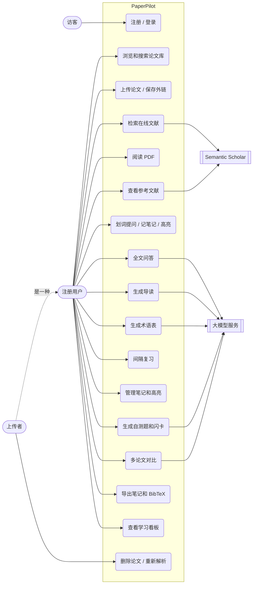

# 需求规格说明

## 1. 引言

### 1.1 目的

本文档描述 PaperPilot 的功能需求和非功能需求，作为设计、实现和测试的依据。文档内容与 `main` 分支的实现保持一致，未实现的功能列在“不在范围内”。

### 1.2 产品概述

PaperPilot 是一个 AI 论文学习网站。用户上传论文 PDF 后，可以在站内阅读，向 AI 提问并追溯到原文页码，也可以生成导读、术语表和自测题，记录笔记和高亮，按间隔重复安排复习。

### 1.3 术语

| 术语 | 含义 |
| :--- | :--- |
| 切块（chunk） | 论文全文按页切成的文本片段，约 1200 字符，带页码 |
| 解析 | 上传后在后台提取 PDF 文字并切块的过程 |
| 外链论文 | 只保存了网址、没有上传 PDF 的论文 |
| 来源页 / 引用 | AI 回答中 `[p.3]` 形式的页码标注，点击可跳到 PDF 对应页 |
| 导读 | AI 生成的论文学习指南，包括研究问题、方法、结论、关键概念和难点 |
| 学习卡片 | 自测选择题和闪卡的统称 |
| 间隔重复 | 答对后逐步拉长复习间隔、答错后重新开始的复习方法 |
| SSE | Server-Sent Events，服务端按事件流推送 AI 回答 |

## 2. 可行性分析

| 方面 | 结论 |
| :--- | :--- |
| 技术 | PDF 文字提取有成熟的 PyMuPDF；单篇论文只有几十到几百个切块，用 BM25 关键词检索即可，不需要向量数据库；大模型通过 OpenAI 兼容接口调用，可以切换不同服务商。界面沿用 cbaldur 项目已有的 Office Ribbon 框架，减少前端工作量。 |
| 经济 | 数据库使用 SQLite，不需要单独的数据库服务；默认模型 DeepSeek 按 token 计费，导读和术语表生成一次后缓存，全站共享，避免重复调用。没有配置 API Key 时，除 AI 功能外的部分照常可用。 |
| 操作 | 用户只需要浏览器。界面提供中文和英文，阅读、提问、记笔记在同一个页面完成。 |
| 法律 | PyMuPDF 采用 AGPL-3.0 许可，公开分发或对外提供服务前需要确认合规；论文 PDF 由用户自行上传，系统不在服务端抓取外部 PDF；前端界面基于 cbaldur 改造，README 中注明来源。 |

## 3. 用户与使用场景

### 3.1 用户角色

| 角色 | 说明 | 权限 |
| :--- | :--- | :--- |
| 访客 | 未登录的用户 | 只能访问登录页和注册页 |
| 注册用户 | 登录后的用户 | 浏览全站论文库，管理自己的阅读进度、笔记、高亮、对话记录和学习卡片 |
| 上传者 | 上传某篇论文的注册用户 | 额外可以删除这篇论文、重新发起解析 |

`users.role_id` 沿用原前端约定（1 普通用户、2 管理员、3 超级管理员），注册用户固定为 1。目前没有管理员专属功能。

### 3.2 典型场景

研究生小王要读一篇英文论文。他把 PDF 上传到 PaperPilot，等待几秒解析完成后打开论文：先看 AI 导读了解大意，再逐页阅读；遇到看不懂的句子，选中后点“提问”，AI 结合当前页解释，并标出来源页；觉得重要的句子用黄色高亮，并转为笔记。读完后生成自测题检验理解，之后几天按复习页的提醒复习答错的题目。写综述时，他在对比页选择三篇论文，比较各自的方法和结论。

### 3.3 用例图

## 4. 功能需求

优先级：P0 为核心流程，P1 为重要功能，P2 为增强功能。全部需求均已实现。

### 4.1 账号

| 编号 | 需求 | 优先级 |
| :--- | :--- | :--- |
| FR-01 | 使用用户名（3–50 字符）、邮箱和密码（8–128 字符）注册，用户名和邮箱不能重复，邮箱不区分大小写 | P0 |
| FR-02 | 使用用户名或邮箱登录，登录状态保持 7 天 | P0 |
| FR-03 | 未登录访问任何业务页面时跳转到登录页 | P0 |
| FR-04 | 退出登录；查看个人信息 | P1 |

### 4.2 论文库

| 编号 | 需求 | 优先级 |
| :--- | :--- | :--- |
| FR-05 | 上传论文：标题、作者、年份必填，摘要、标签（最多 10 个）选填，PDF 和网址至少提供一项；PDF 不超过 20 MB | P0 |
| FR-06 | 论文库全站共享，按标题、作者、标签和摘要搜索，分页浏览，最新的在前 | P0 |
| FR-07 | 通过 Semantic Scholar 检索库外论文，并以外链方式加入论文库 | P2 |
| FR-08 | 上传者可以删除论文，删除时一并清除文件、切块和所有用户的相关数据 | P1 |
| FR-09 | 上传后在后台解析全文，状态依次为“等待中、解析中、可用 / 无文字 / 失败”，失败时上传者可以重试 | P0 |

### 4.3 阅读

| 编号 | 需求 | 优先级 |
| :--- | :--- | :--- |
| FR-10 | 站内阅读 PDF，支持翻页、跳页和缩放 | P0 |
| FR-11 | 自动记住每个用户在每篇论文上次读到的页，再次打开时恢复 | P1 |
| FR-12 | 阅读状态分为未读、在读、已读，翻页时自动标记为在读，可以手动标记为已读 | P1 |
| FR-13 | 选中 PDF 中的文字后弹出工具条，可以直接提问、记笔记或高亮 | P1 |
| FR-14 | 高亮有黄、绿、粉三种颜色，缩放后位置不变，可以改颜色、删除、转为笔记 | P2 |
| FR-15 | 从 PDF 解析参考文献列表，每条可以检索 Semantic Scholar 并加入论文库 | P2 |

### 4.4 AI 学习

| 编号 | 需求 | 优先级 |
| :--- | :--- | :--- |
| FR-16 | 针对单篇论文流式问答，回答依据论文全文，标注来源页，点击来源跳到 PDF 对应页 | P0 |
| FR-17 | 支持追问；中文问题可以检索英文论文；划词提问时 AI 能看到当前页的内容 | P0 |
| FR-18 | 对话记录按用户和论文保存，刷新后恢复，可以清空 | P1 |
| FR-19 | 只有外链没有全文的论文，AI 基于摘要回答，并明确说明 | P1 |
| FR-20 | 生成导读，按中文和英文分别缓存，全站共享，可以重新生成 | P0 |
| FR-21 | 生成术语表（最多 15 个），每个术语标注首次出现的页码，点击跳转 | P2 |
| FR-22 | 生成 5 道选择题和 5 张闪卡，每个用户各自一份，重复生成时跳过已有题目 | P1 |
| FR-23 | 选择 2–4 篇论文对比问答，来源标注到具体论文和页码 | P2 |
| FR-24 | 没有配置大模型时，AI 入口显示未配置的说明，其他功能照常使用 | P1 |

### 4.5 笔记与复习

| 编号 | 需求 | 优先级 |
| :--- | :--- | :--- |
| FR-25 | 边读边记笔记，可以记录页码，支持编辑和删除 | P0 |
| FR-26 | “我的笔记”页跨论文搜索、按论文筛选，显示笔记总数、近 7 天新增数和高亮数 | P1 |
| FR-27 | 笔记按论文和页码导出为 Markdown；单篇或整个论文库导出为 BibTeX | P2 |
| FR-28 | 复习页按到期时间列出待复习的卡片，答对后间隔依次为 1、3、7、14、30 天，答错回到待复习 | P1 |
| FR-29 | 显示复习进度：总数、待复习、已掌握、未来 7 天的到期分布、各论文进度 | P2 |

### 4.6 看板与界面

| 编号 | 需求 | 优先级 |
| :--- | :--- | :--- |
| FR-30 | 学习看板显示论文总数、在读数、已读数、笔记数、待复习数，最近 14 天的活动趋势和最近在读的 5 篇论文；按用户所在时区分天 | P1 |
| FR-31 | 界面支持简体中文和英文切换，AI 生成的导读、术语表和题目跟随界面语言 | P1 |

## 5. 主要用例描述

### UC3 上传论文

| 项目 | 内容 |
| :--- | :--- |
| 参与者 | 注册用户 |
| 前置条件 | 已登录 |
| 主流程 | 1. 在论文库点击上传；2. 填写标题、作者、年份，选择 PDF；3. 提交后论文出现在列表中，状态为“等待中”；4. 后台解析完成后状态变为“可用” |
| 异常流程 | 文件不是 PDF、超过 20 MB 或字段不合法：提示错误，不保存。扫描版 PDF：状态为“无文字”，AI 只能基于摘要回答。PDF 损坏或加密：状态为“失败”，上传者可以重试 |
| 后置条件 | 论文对所有用户可见 |

### UC6 全文问答

| 项目 | 内容 |
| :--- | :--- |
| 参与者 | 注册用户、大模型服务 |
| 前置条件 | 已登录；论文解析完成，或至少有摘要；已配置大模型 |
| 主流程 | 1. 在详情页右侧“AI 问答”输入问题；2. 系统检索相关切块，先返回来源页列表；3. 回答逐字显示，句末带 `[p.页码]`；4. 点击来源跳到 PDF 对应页；5. 回答完成后保存这一轮对话 |
| 异常流程 | 论文还在解析：提示稍后再试。模型调用失败：显示错误，不保存。回答超长被截断：提示把问题拆小。用户中途停止：不保存半句话 |
| 后置条件 | 对话记录只有本人可见 |

### UC7 划词操作

| 项目 | 内容 |
| :--- | :--- |
| 参与者 | 注册用户 |
| 主流程 | 1. 在 PDF 上选中一段文字；2. 松开鼠标后选区上方出现工具条；3a. 点“提问”：问题填入问答输入框，用户可以修改后发送，请求带上当前页码；3b. 点“笔记”：引用原文和页码创建笔记；3c. 点颜色：在原位置保存高亮 |
| 异常流程 | 点击空白处取消选区时工具条收起 |

### UC8 生成导读

| 项目 | 内容 |
| :--- | :--- |
| 参与者 | 注册用户、大模型服务 |
| 主流程 | 1. 打开“导读”标签；2. 已有缓存时直接显示；3. 没有缓存时点击生成，内容流式显示；4. 生成完整后写入缓存，其他用户打开同一篇论文同一语言时直接读取 |
| 异常流程 | 生成失败、被截断或中途停止：不写缓存，可以重新生成 |

### UC11 间隔复习

| 项目 | 内容 |
| :--- | :--- |
| 参与者 | 注册用户 |
| 前置条件 | 已为至少一篇论文生成学习卡片 |
| 主流程 | 1. 打开复习页，看到待复习数量和到期分布；2. 开始复习，逐张作答（选择题选选项，闪卡翻面后自评）；3. 答对的卡片推迟到下一档间隔，答错的立即回到待复习；4. 结束后显示本轮得分 |
| 后置条件 | 连续答对 3 次（间隔达到 7 天）的卡片计为已掌握 |

## 6. 非功能需求

| 编号 | 类别 | 需求 |
| :--- | :--- | :--- |
| NFR-01 | 安全 | 密码使用 argon2 哈希；登录凭证是 HttpOnly、SameSite=Lax 的 Cookie，前端脚本读不到 |
| NFR-02 | 安全 | 登录失败时不区分“用户不存在”和“密码错误”，响应耗时也接近，避免枚举账号 |
| NFR-03 | 安全 | 个人数据按用户隔离，访问别人的笔记、高亮、卡片返回 404 |
| NFR-04 | 安全 | 上传文件校验扩展名、类型和 `%PDF-` 文件头，服务端用随机文件名存储；外链论文不在服务端下载，避免 SSRF |
| NFR-05 | 安全 | 论文内容放在分隔标签中交给模型，声明为数据而非指令，降低提示词注入风险 |
| NFR-06 | 安全 | JWT 密钥必须配置且至少 32 字符，否则服务拒绝启动；真实密钥只放在被 git 忽略的 `.env` 中 |
| NFR-07 | 可靠性 | 解析失败一律落到“失败”状态，不会停在“解析中”；服务重启后自动继续未完成的解析 |
| NFR-08 | 可靠性 | AI 回答只在完整结束后保存或缓存，失败、截断、中途停止都不留下残缺内容 |
| NFR-09 | 可靠性 | AI 给出的页码必须在检索内容或全文中能确认，否则不显示为来源 |
| NFR-10 | 性能 | AI 回答流式输出，用户不必等待完整生成；导读和术语表缓存后再次打开不调用模型 |
| NFR-11 | 性能 | pdf.js、ECharts 等大体积依赖按需加载 |
| NFR-12 | 可用性 | 中英文界面；错误信息以文字提示，不显示内部细节 |
| NFR-13 | 可维护性 | 后端代码通过 ruff 检查，业务逻辑有自动化测试；数据库变更通过 Alembic 迁移，测试检查迁移与模型一致 |
| NFR-14 | 可移植性 | 提供 Docker Compose 部署配置（前端 nginx + 后端 FastAPI） |

## 7. 约束与假设

- 数据库使用 SQLite，适合单机部署，不支持多实例。
- AI 功能依赖外部 OpenAI 兼容接口，响应速度和费用取决于服务商。
- 不做 OCR，扫描版 PDF 无法全文问答。
- 没有邮件服务，因此不提供找回密码和邮箱验证。

## 8. 不在范围内

以下功能目前没有实现：找回密码、第三方登录、管理员后台、OCR、论文全文翻译、多人协作批注、移动端专门适配。
