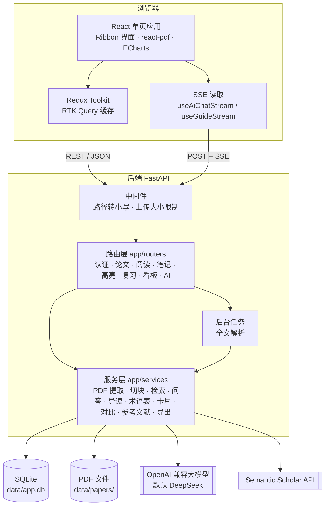
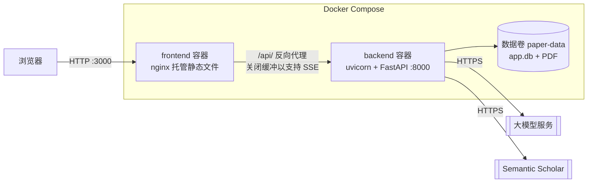
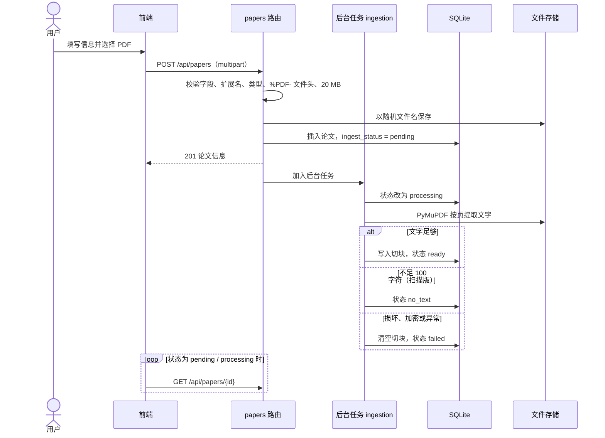
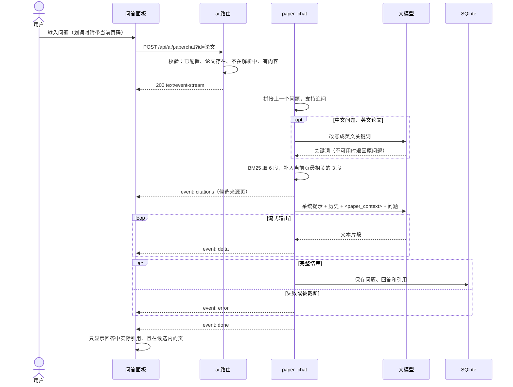
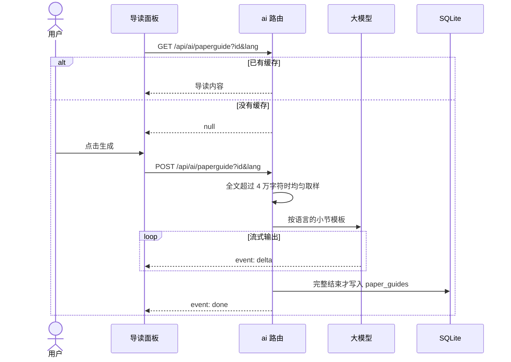
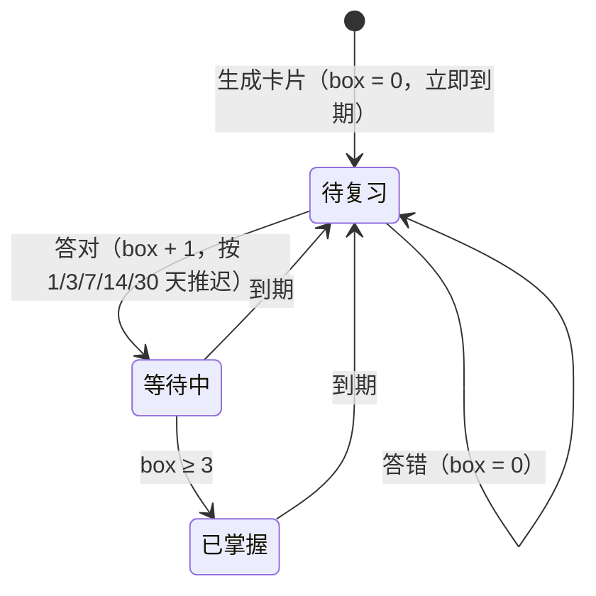

# 概要设计

## 1. 设计目标

- 阅读、提问、记笔记在同一个页面完成，AI 回答能追溯到原文页码。
- 部署简单：单机即可运行，不依赖独立的数据库服务和向量数据库。
- AI 服务可替换：任何 OpenAI 兼容接口都能接入，未配置时站点照常运行。
- 个人数据按用户隔离，论文和 AI 生成的公共内容全站共享。

## 2. 系统架构

系统采用前后端分离的三层结构：浏览器中的单页应用、FastAPI 接口服务、SQLite 数据库和本地文件存储。大模型和 Semantic Scholar 是外部服务。

### 2.1 分层职责

| 层 | 位置 | 职责 |
| :--- | :--- | :--- |
| 表现层 | `cbaldur-frontend/src/routes`、`components` | 页面和交互，Ribbon 外壳沿用 cbaldur |
| 前端状态 | `src/redux`、`src/hooks` | RTK Query 管理接口缓存和失效；自定义 Hook 处理流式回答、阅读页码保存和划词 |
| 接口层 | `paper-backend/app/routers` | 参数校验、身份认证、权限和用户隔离，返回 camelCase JSON |
| 业务层 | `paper-backend/app/services` | 与 HTTP 无关的业务逻辑，可以单独测试 |
| 数据层 | `app/models.py`、`alembic/` | SQLAlchemy 模型和迁移 |
| 基础设施 | `app/config.py`、`app/db.py`、`app/security.py`、`app/middleware.py`、`app/errors.py` | 配置、数据库连接、密码和 JWT、中间件、统一错误格式 |

## 3. 技术选型

| 需求 | 选择 | 理由 |
| :--- | :--- | :--- |
| 界面框架 | 沿用 cbaldur 前端（React 19、TypeScript、Tailwind CSS 4、shadcn/ui） | 已有完整的 Ribbon 布局、国际化和登录页，只需替换业务模块 |
| 前端状态 | Redux Toolkit + RTK Query | 原项目已在使用；接口缓存按标签失效，保存笔记后列表自动刷新 |
| PDF 渲染 | react-pdf（pdf.js） | 提供文本层，支持划词和高亮定位 |
| 后端框架 | FastAPI | 类型注解即校验规则，自动生成 OpenAPI；原生支持流式响应 |
| 数据库 | SQLite + SQLAlchemy 2 + Alembic | 无需单独部署；开启 WAL 和外键约束；迁移可追溯 |
| PDF 提取 | PyMuPDF | 按页提取文字，速度快，能识别加密和损坏的文件 |
| 检索 | rank-bm25 | 单篇论文切块少，关键词检索足够；不需要 embedding 接口（默认的 DeepSeek 没有提供） |
| 大模型 | openai SDK 调用 OpenAI 兼容接口 | 可以切换 DeepSeek、OpenAI 或本地模型，只改环境变量 |
| 认证 | JWT（HS256）+ HttpOnly Cookie，argon2 哈希 | 前端脚本读不到令牌；沿用原前端的 `AuthToken` Cookie 约定 |
| 部署 | Docker Compose：nginx 托管前端并反向代理 `/api` | 两个容器即可运行 |

## 4. 模块划分

### 4.1 后端模块

| 模块 | 路由 | 服务 | 说明 |
| :--- | :--- | :--- | :--- |
| 认证 | `auth.py`、`users.py` | `security.py` | 注册、登录、退出、校验登录、个人信息 |
| 论文库 | `papers.py` | `storage.py`、`semantic_scholar.py`、`export.py`、`references.py` | 增删查、上传下载、在线检索、BibTeX、参考文献 |
| 全文解析 | `papers.py`（重试） | `ingestion.py`、`pdf_text.py`、`chunking.py` | 后台提取文字、切块、状态流转 |
| 阅读进度 | `reading.py` | — | 阅读状态和上次页码 |
| 笔记 | `notes.py` | `export.py` | 笔记增删改查、统计、Markdown 导出 |
| 高亮 | `highlights.py` | — | 高亮增删改，关联笔记 |
| 学习卡片 | `study.py`、`ai.py`（生成） | `study_cards.py` | 生成、复习调度、进度统计 |
| 看板 | `dashboard.py` | — | 统计和最近活动 |
| AI | `ai.py` | `llm.py`、`llm_json.py`、`retrieval.py`、`paper_chat.py`、`paper_guide.py`、`paper_glossary.py`、`paper_compare.py` | 问答、对话记录、导读、术语表、对比 |

### 4.2 前端模块

| 页面 | 路由 | 主要组件 |
| :--- | :--- | :--- |
| 登录 / 注册 | `/auth/sign-in`、`/auth/sign-up` | `routes/auth` |
| 学习看板 | `/` | `StatCard`、`ActivityChart` |
| 论文库 | `/papers` | 上传对话框、在线检索、`useSaveGlobalPaper` |
| 论文详情 | `/papers/:id` | 左侧 `PdfReader`、`HighlightLayer`、`SelectionToolbar`；右侧标签页：问答 `PaperAssistant`、导读 `PaperGuide`、笔记 `NotesPanel`、自测 `StudyPanel`、术语 `PaperGlossary`、参考文献 `ReferencesPanel`、信息 |
| 我的笔记 | `/notes` | `NoteItem`、`HighlightItem`、`ExportLink` |
| 复习 | `/review` | `StudySession`、未来 7 天到期分布 |
| 对比 | `/compare` | 论文选择、`AiChatPanel` |
| 个人中心 | `/user` | 个人信息 |

界面语言在底部状态栏 `StatusBar` 中切换，保存在 Redux 的 `localeSlice`；退出登录在 Ribbon 布局 `RibbonLayout` 中。

## 5. 部署结构

- nginx 对 `/api/` 关闭 `proxy_buffering`，读超时 1 小时，保证流式回答逐字到达浏览器；上传上限 22 MB（PDF 20 MB 加表单余量）。
- 后端通过环境变量配置，`JWT_KEY` 未设置时 Compose 直接报错。
- 本地开发时 Rsbuild 开发服务器把 `/api` 代理到 `localhost:5168`。

> Docker 部署配置已编写并通过 `docker compose config` 校验，但还没有实际构建运行过，见[测试报告](06-test-report.md#7-未验证事项)。

## 6. 关键流程

### 6.1 上传与全文解析

服务重启时，`lifespan` 会找出仍处于 `pending`、`processing` 的论文重新解析，因为 FastAPI 的后台任务只存在于进程内存中。

### 6.2 全文问答

所有校验在开始流式输出之前完成，失败时返回普通 JSON 错误，前端可以读取 `message` 显示原因。

### 6.3 导读生成与缓存

术语表和学习卡片使用非流式的 JSON 输出，流程类似：调用模型，逐条校验结果，再保存。

### 6.4 间隔复习

“已掌握”是统计口径，不是单独的状态字段：box 达到 3 的卡片仍会按间隔到期复习，答错后 box 归零。

## 7. 横切设计

### 7.1 安全

| 风险 | 措施 |
| :--- | :--- |
| 令牌被脚本窃取 | JWT 放在 HttpOnly Cookie 中，SameSite=Lax；生产环境可开启 `COOKIE_SECURE` |
| 弱密钥 | `JWT_KEY` 至少 32 字符，没有默认值，缺失时启动失败 |
| 账号枚举 | 登录失败统一返回“用户名或密码错误”；用户不存在时也做一次哈希校验 |
| 越权访问 | 个人数据查询都带 `user_id` 条件，查不到时返回 404，不暴露数据是否存在 |
| 恶意上传 | 中间件按 `Content-Length` 提前拒绝超大请求；路由校验扩展名、类型和文件头；随机文件名存储 |
| SSRF | 外链论文只保存网址，下载时重定向，服务端不发起请求 |
| 提示词注入 | 论文内容放在 `<paper_context>` 标签中，提示词声明其为数据；论文文本中的同名标签被移除，无法提前闭合 |
| 模型编造页码 | 来源页只能来自检索结果；术语页码由服务端在全文中查找；卡片页码必须在上下文中出现 |

### 7.2 错误处理

- 所有错误响应格式统一为 `{"success": false, "message": "..."}`，校验错误给出字段名，未知异常只返回“服务器内部错误”并记录日志。
- 流式接口在响应开始后出错时，发送 `error` 事件，再发送 `done` 事件结束。

### 7.3 数据共享与隔离

| 全站共享 | 按用户隔离 |
| :--- | :--- |
| 论文、PDF、切块、导读、术语表 | 阅读状态、笔记、高亮、对话记录、学习卡片 |

论文由上传者管理，其他用户只能阅读；删除论文时数据库外键级联删除所有关联数据。

### 7.4 国际化

前端使用 react-intl，文案放在 `src/i18n/messages/zh-CN.ts` 和 `en.ts`。导读、术语表、学习卡片的生成请求带上 `lang`，按语言分别缓存。
