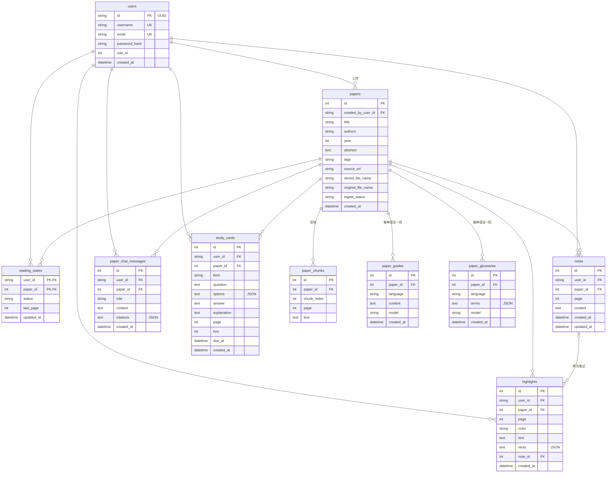

# 数据库设计

## 1. 概述

- 数据库：SQLite，文件位于 `paper-backend/data/app.db`（Docker 中位于数据卷 `/app/data`）。
- 连接时开启 `PRAGMA foreign_keys=ON`，保证外键和级联删除生效；开启 `PRAGMA journal_mode=WAL`，读写可以并发。
- ORM：SQLAlchemy 2，模型定义在 `app/models.py`；表结构变更通过 Alembic 迁移，`tests/test_migrations.py` 检查迁移结果与模型一致。
- 时间统一按 UTC 保存。SQLite 不保存时区，读出后由代码补上 UTC。
- PDF 文件不存入数据库，保存在 `data/papers/`，数据库只记录随机生成的存储文件名。

共 10 张表，按数据归属分为三类：

| 类别 | 表 | 说明 |
| :--- | :--- | :--- |
| 账号 | `users` | 用户 |
| 全站共享 | `papers`、`paper_chunks`、`paper_guides`、`paper_glossaries` | 论文、全文切块和 AI 生成的公共内容 |
| 按用户隔离 | `reading_states`、`notes`、`highlights`、`paper_chat_messages`、`study_cards` | 每个用户自己的学习数据 |

## 2. ER 图

## 3. 数据字典

“级联”指父记录删除时子记录随之删除。

### 3.1 users 用户

| 字段 | 类型 | 约束 | 说明 |
| :--- | :--- | :--- | :--- |
| id | VARCHAR(36) | 主键 | UUID |
| username | VARCHAR(50) | 唯一，非空 | 去掉首尾空格后保存 |
| email | VARCHAR(254) | 唯一，非空 | 转为小写后保存 |
| password_hash | VARCHAR(255) | 非空 | argon2 哈希 |
| role_id | INTEGER | 默认 1 | 1 普通用户、2 管理员、3 超级管理员；注册时固定为 1 |
| created_at | DATETIME | 非空 | 注册时间 |

### 3.2 papers 论文

| 字段 | 类型 | 约束 | 说明 |
| :--- | :--- | :--- | :--- |
| id | INTEGER | 主键，自增 | |
| created_by_user_id | VARCHAR(36) | 外键 users.id，索引 | 上传者，只有上传者能删除和重新解析 |
| title | VARCHAR(500) | 非空 | |
| authors | VARCHAR(1000) | 非空 | 作者列表原文 |
| year | INTEGER | 非空，索引 | 1500 到下一年之间 |
| abstract | TEXT | 默认空串 | 最多 2 万字符；没有全文时 AI 基于摘要回答 |
| tags | VARCHAR(500) | 默认空串 | 英文逗号分隔（中文逗号也能识别），忽略大小写去重，最多 10 个，每个最多 32 字符 |
| source_url | VARCHAR(2048) | 可空 | 只允许 http / https |
| stored_file_name | VARCHAR(128) | 可空 | 服务端随机文件名；为空表示外链论文 |
| original_file_name | VARCHAR(500) | 可空 | 用户上传时的文件名 |
| ingest_status | VARCHAR(16) | 默认 `none`，索引 | 全文解析状态，见下表 |
| created_at | DATETIME | 索引 | 列表按它倒序 |

`ingest_status` 取值：

| 值 | 含义 |
| :--- | :--- |
| none | 没有本地 PDF（外链论文） |
| pending | 已上传，等待解析 |
| processing | 正在解析 |
| ready | 解析完成，可以全文问答 |
| no_text | 提取到的文字不足 100 字符，通常是扫描版 |
| failed | PDF 损坏、加密或解析出错 |

### 3.3 paper_chunks 全文切块

| 字段 | 类型 | 约束 | 说明 |
| :--- | :--- | :--- | :--- |
| id | INTEGER | 主键 | |
| paper_id | INTEGER | 外键 papers.id，级联，索引 | |
| chunk_index | INTEGER | 非空 | 在全文中的顺序 |
| page | INTEGER | 非空 | 所在页码，从 1 开始；切块不跨页 |
| text | TEXT | 非空 | 约 1200 字符，相邻切块重叠 150 字符 |

### 3.4 paper_guides 导读缓存

| 字段 | 类型 | 约束 | 说明 |
| :--- | :--- | :--- | :--- |
| id | INTEGER | 主键 | |
| paper_id | INTEGER | 外键 papers.id，级联 | |
| language | VARCHAR(8) | 与 paper_id 联合唯一 | `zh-CN` 或 `en` |
| content | TEXT | 非空 | Markdown |
| model | VARCHAR(200) | 非空 | 生成时使用的模型 |
| created_at | DATETIME | | |

### 3.5 paper_glossaries 术语表缓存

| 字段 | 类型 | 约束 | 说明 |
| :--- | :--- | :--- | :--- |
| id | INTEGER | 主键 | |
| paper_id | INTEGER | 外键 papers.id，级联 | |
| language | VARCHAR(8) | 与 paper_id 联合唯一 | |
| terms | TEXT | 非空 | JSON 数组，每项为 `term`、`explanation`、`page` |
| model | VARCHAR(200) | 非空 | |
| created_at | DATETIME | | |

术语只在展示时整体读取，不需要按术语查询，所以存为 JSON 而不单独建表。

### 3.6 reading_states 阅读进度

| 字段 | 类型 | 约束 | 说明 |
| :--- | :--- | :--- | :--- |
| user_id | VARCHAR(36) | 联合主键，外键 users.id，级联 | |
| paper_id | INTEGER | 联合主键，外键 papers.id，级联 | |
| status | VARCHAR(16) | 默认 `unread` | `unread` / `reading` / `done` |
| last_page | INTEGER | 默认 1 | 上次读到的页 |
| updated_at | DATETIME | 更新时自动刷新 | 看板“最近活动”和“继续阅读”按它统计 |

没有记录时视为未读，不预先为每个用户创建记录。

### 3.7 notes 笔记

| 字段 | 类型 | 约束 | 说明 |
| :--- | :--- | :--- | :--- |
| id | INTEGER | 主键 | |
| user_id | VARCHAR(36) | 外键 users.id，级联，索引 | |
| paper_id | INTEGER | 外键 papers.id，级联，索引 | |
| page | INTEGER | 可空 | 笔记对应的页 |
| content | TEXT | 非空 | 最多 1 万字符 |
| created_at / updated_at | DATETIME | | |

### 3.8 highlights 高亮

| 字段 | 类型 | 约束 | 说明 |
| :--- | :--- | :--- | :--- |
| id | INTEGER | 主键 | |
| user_id | VARCHAR(36) | 外键 users.id，级联 | |
| paper_id | INTEGER | 外键 papers.id，级联 | |
| page | INTEGER | 非空 | |
| color | VARCHAR(16) | 非空 | `yellow` / `green` / `pink` |
| text | TEXT | 非空 | 高亮的原文，最多 5000 字符 |
| rects | TEXT | 非空 | JSON 数组，每项 `x`、`y`、`width`、`height` 都是相对页面宽高的比例（0–1），缩放后仍然准确 |
| note_id | INTEGER | 外键 notes.id，删除时置空 | 转为笔记后关联；笔记删除后高亮保留 |
| created_at | DATETIME | | |

索引：`ix_highlights_user_paper (user_id, paper_id)`，阅读页按用户和论文加载高亮。

### 3.9 paper_chat_messages 对话记录

| 字段 | 类型 | 约束 | 说明 |
| :--- | :--- | :--- | :--- |
| id | INTEGER | 主键 | |
| user_id | VARCHAR(36) | 外键 users.id，级联 | |
| paper_id | INTEGER | 外键 papers.id，级联 | |
| role | VARCHAR(16) | 非空 | `user` / `assistant` |
| content | TEXT | 非空 | |
| citations | TEXT | 默认 `[]` | JSON 数组，每项 `page`、`snippet` |
| created_at | DATETIME | | |

索引：`ix_paper_chat_messages_user_paper (user_id, paper_id)`。一轮问答完整结束后，问题和回答在同一个事务中写入。

### 3.10 study_cards 学习卡片

| 字段 | 类型 | 约束 | 说明 |
| :--- | :--- | :--- | :--- |
| id | INTEGER | 主键 | |
| user_id | VARCHAR(36) | 外键 users.id，级联 | |
| paper_id | INTEGER | 外键 papers.id，级联 | |
| kind | VARCHAR(16) | 非空 | `quiz` 选择题 / `flashcard` 闪卡 |
| question | TEXT | 与 user_id、paper_id 联合唯一 | 重复生成时按题目去重，保留已有进度 |
| options | TEXT | 默认 `[]` | 选择题选项，JSON 数组 |
| answer | TEXT | 非空 | 选择题为正确选项原文，闪卡为背面内容 |
| explanation | TEXT | 默认空串 | 解析 |
| page | INTEGER | 可空 | 出处页码，必须在出题时的上下文中出现过 |
| box | INTEGER | 默认 0 | 间隔重复的盒子序号，答对加一，答错归零 |
| due_at | DATETIME | | 下次复习时间，新卡片立即到期 |
| created_at | DATETIME | | |

索引：`ix_study_cards_user_due (user_id, due_at)`，复习页按用户查询到期卡片。

## 4. 设计说明

### 4.1 为什么共享导读、术语表，而不共享卡片

导读和术语表只取决于论文内容和语言，所有人看到的结果相同，共享后同一篇论文只需调用一次模型。学习卡片带有每个人的复习进度，必须每人一份。

### 4.2 JSON 字段

`terms`、`rects`、`citations`、`options` 都只在读取时整体展示，从不按其中的元素查询或统计，单独建表只会增加连接查询，所以存为 JSON 文本，写入前在接口层校验结构。

### 4.3 删除策略

| 删除对象 | 影响 |
| :--- | :--- |
| 论文 | 级联删除切块、导读、术语表，以及所有用户的阅读进度、笔记、高亮、对话和卡片；同时删除 PDF 文件 |
| 笔记 | 关联的高亮保留，`note_id` 置空 |
| 高亮 | 关联的笔记保留 |
| 用户 | 级联删除该用户的个人数据（目前没有删除账号的接口） |

### 4.4 并发写入

- 两个人同时生成同一篇论文同一语言的导读或术语表时，联合唯一约束会让后写入的一方失败，代码捕获 `IntegrityError` 后丢弃这份结果，不影响已保存的内容。
- 回答或生成期间论文被删除，写入时外键约束失败，同样只记录日志。
- 同一用户并发生成学习卡片，题目唯一约束冲突时返回 409，提示稍后刷新。

## 5. 迁移记录

迁移文件位于 `paper-backend/alembic/versions/`，按以下顺序执行：

| 顺序 | 版本 | 内容 |
| :--- | :--- | :--- |
| 1 | `b494fb2310fd` | 创建 users |
| 2 | `50a3bb2ddfcf` | 创建 papers |
| 3 | `090d96ee6ccd` | 创建 reading_states |
| 4 | `b2f93ec4dcd2` | 创建 paper_chunks，papers 增加 ingest_status；已有本地 PDF 的论文标记为 pending，启动后自动解析 |
| 5 | `a161b4a5884f` | 创建 paper_guides |
| 6 | `beb118acf907` | 创建 notes |
| 7 | `a855a7e8a7b8` | 创建 paper_chat_messages |
| 8 | `6f047396c208` | 创建 study_cards |
| 9 | `e4cb9997c141` | 创建 highlights |
| 10 | `83fb112268c1` | 创建 paper_glossaries（当前最新） |

升级命令：`cd paper-backend && .venv/bin/alembic upgrade head`。修改模型后用 `alembic revision --autogenerate -m "说明"` 生成新迁移。
