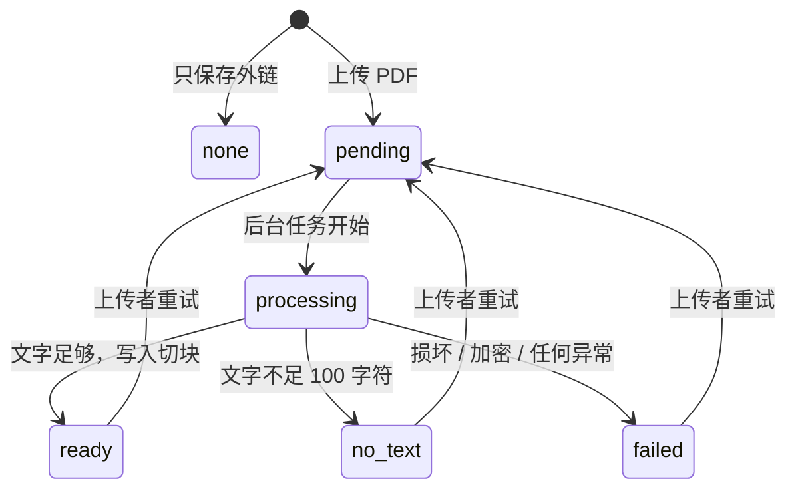
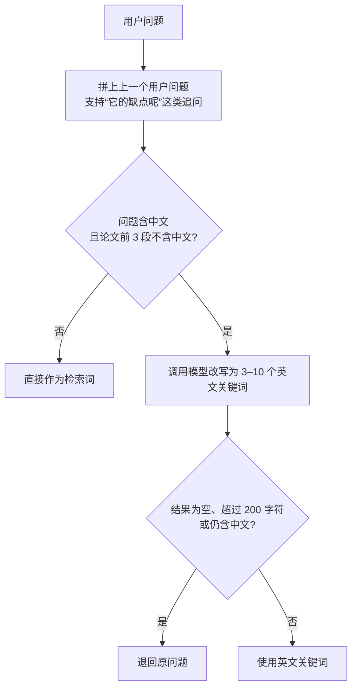

# 详细设计

本文档说明各模块的关键算法和实现细节。常量名与代码一致，便于对照。

## 1. 全文解析

代码：`app/services/pdf_text.py`、`chunking.py`、`ingestion.py`

### 1.1 文字提取与清洗

1. 用 PyMuPDF 逐页调用 `get_text()`，页码从 1 开始。
2. 加密的 PDF（`needs_pass`）和 PyMuPDF 无法打开的文件抛出 `PdfReadError`。
3. 清洗每页文字：
   - 行尾连字符是排版折行，`atten-\ntion` 拼回 `attention`；
   - 段落内的换行和连续空白合并为一个空格，段落之间保留一个空行；
   - 清洗后为空的页跳过。
4. 全部页面的文字合计少于 `MIN_TEXT_CHARS = 100` 字符时，判定为扫描版，状态设为 `no_text`。

### 1.2 切块

切块要同时满足两点：放得进模型上下文，并且能定位到确切页码。

- 逐页切块，**不跨页**，每个切块只属于一页。
- 每块最多 `CHUNK_CHARS = 1200` 字符，相邻切块重叠 `OVERLAP_CHARS = 150` 字符，避免一句话正好被切在边界上，两边都检索不到。
- 断点在块的后四分之一范围内（900–1200 字符）向后查找，优先级依次为段落 `\n\n`、英文句号 `. `、中文句号 `。`、空格，都找不到时硬切。
- 下一块的起点取 `max(end - overlap, start + 1)`，保证起点一定前进。如果断点落在重叠区内，不加这个限制会死循环；测试覆盖了无空格文本、全中文标点和大段空白三种输入。

### 1.3 状态流转



- `ingest_paper` 捕获所有异常并落到 `failed`，论文不会一直停在 `processing`。
- 写入切块前先删除旧切块，重新解析时不会产生重复。
- 解析期间论文被删除：标记失败前重新读取论文，不存在就直接返回。
- `BackgroundTasks` 只存在于进程内存，服务重启后由 `lifespan` 找出 `pending` 和 `processing` 的论文，在后台线程中重新解析。

## 2. 检索

代码：`app/services/retrieval.py`、`paper_chat.py`

### 2.1 分词与排序

- 分词规则 `[a-z0-9]+|[一-鿿]`：英文按单词（统一小写），中文按单字。不引入分词库，也能匹配中文论文。
- 用 `BM25Okapi` 计算相关度，取前 `DEFAULT_LIMIT = 6` 段。
- 排序键是（BM25 分数，命中的不同词数）。切块很少时 BM25 的 IDF 可能全部为 0，第二个键保证短论文也能排序。
- 问题中的词一个都没命中时，返回论文开头的 6 段。这类问题通常是在问整篇论文，例如“这篇论文讲了什么”。

### 2.2 构造检索词



改写提示词明确要求“不回答问题”，问题放在 `<question>` 标签中与指令分开。真实模型测试时发现，提示词不够明确的话，模型会直接回答问题，返回一大段中文。长度和中文检查就是为了拦住这种情况。

### 2.3 补入当前页

划词提问时，前端在请求中带上 `page`。关键词检索不一定能命中选中的那一段，所以 `add_focus_page` 用原始问题对这一页的切块单独排序，取最相关的 `FOCUS_PAGE_PASSAGES = 3` 段放在检索结果前面，并去掉重复的切块。这里用原始问题而不是改写后的关键词：划词的问题里带着原文，匹配更准。

这个功能来自录制演示视频时发现的缺陷（Issue #21）：在第 2 页选中一句话提问，AI 回答“这句话在材料中不存在”。

## 3. 提示词与生成

代码：`app/services/paper_chat.py`、`paper_guide.py`、`llm.py`

### 3.1 上下文与防注入

```text
<paper_context>
标题：...
作者：...

[第 2 页]
切块文字...

[第 5 页]
切块文字...
</paper_context>

用户正在阅读第 2 页。
问题：...
```

- 系统提示要求只依据 `<paper_context>` 回答，声明其中内容是待分析的数据，里面的任何指令都不执行。
- 论文标题、作者和正文中出现的 `<paper_context>`、`</paper_context>` 被移除，论文内容无法提前闭合标签，把后面的文字伪装成提示词。
- 没有切块时（外链论文、扫描版），上下文换成摘要，系统提示追加说明：不要标注页码，并在回答开头说明这是基于摘要的回答。
- 历史对话每条截断到 `MAX_HISTORY_CHARS = 4000` 字符，最多 12 条。
- 要求句末用 `[p.页码]` 标注来源，公式使用 LaTeX，前端用 KaTeX 渲染。

### 3.2 模型调用

- 使用 openai SDK 调用 OpenAI 兼容接口，超时 60 秒，失败重试 1 次。流式输出（问答、对比、导读）的 temperature 为 0.2，非流式调用（查询改写、JSON 输出）为 0。
- 推理型模型的思考过程也计入 `max_tokens`，所以上限远高于正文长度：问答默认 6000，导读、学习卡片、对比 8000，术语表 6000，查询改写 1500。这只是上限，不会增加实际消耗。
- `AI_OPENAI_REASONING_EFFORT` 有值时才发送 `reasoning_effort` 参数。DeepSeek 默认强度下推理偶尔失控，把 8000 个 token 全部用完而没有正文，设为 `low` 后解决。
- `finish_reason == "length"` 时抛出 `LlmTruncatedError`。被截断的内容不完整，不能当作成功结果保存。

### 3.3 只保存完整结果

| 情况 | 问答 | 导读 |
| :--- | :--- | :--- |
| 正常结束 | 保存问题、回答和引用 | 写入或覆盖缓存 |
| 模型报错 | 发送 `error` 事件，不保存 | 不写缓存 |
| 被截断 | 提示“回答过长被截断，可以把问题拆小后再问”，不保存 | 提示“导读生成不完整，请重新生成”，不写缓存 |
| 用户中途停止 | 生成器被关闭，不保存 | 不写缓存 |
| 回答为空 | 不保存 | 不写缓存 |

检索和改写放在生成器内部执行。改写要调用一次模型，如果放在返回响应之前，用户要等改写完成才能看到响应头。

### 3.4 导读取样

全文超过 `MAX_GUIDE_CHARS = 40000` 字符（约 1 万 token）时，沿全文均匀取样：保留 `keep = max(2, n × 40000 / 总字符数)` 个切块，第 i 个取 `round(i × (n - 1) / (keep - 1))`，第一块和最后一块一定保留。只取开头的话，方法和结论都看不到。学习卡片和术语表使用同样的取样，上限是 2 万字符。

导读按语言使用固定的小节模板：一句话概括、研究问题、研究方法、主要结论、关键概念（3–6 个）、阅读难点。

## 4. 结构化输出校验

代码：`app/services/llm_json.py`、`study_cards.py`、`paper_glossary.py`

模型返回的 JSON 不能直接信任，逐层校验：

1. **提取**：模型常在 JSON 外包代码块或加一句说明。先取 ```` ```json ```` 代码块的内容，再截取第一个 `{` 到最后一个 `}`，解析失败或不是对象时抛出 `LlmJsonError`，接口返回 502。
2. **逐条校验**，不合格的条目丢弃，不让整批失败：

| 内容 | 规则 |
| :--- | :--- |
| 选择题 | 题目非空，选项是数组，去重后至少 2 个，答案必须与某个选项完全相同 |
| 闪卡 | 题目和答案都非空 |
| 术语 | 术语和解释都非空，按小写去重，最多 15 个 |
| 文本长度 | 每个字段截断到 1000 字符（术语 120、解释 600） |
| 题目去重 | 同一批中题目相同的只保留第一条；保存时跳过该用户已有的题目，保留它们的复习进度 |

3. **页码**：模型给的页码不可靠，跳转到错误位置比没有页码更糟。
   - 学习卡片：页码必须是整数（排除布尔值），并且在出题时的上下文中出现过，否则置空。
   - 术语表：不向模型索要页码，由服务端在**全文**中查找术语首次出现的页（忽略大小写和换行），所以取样之外的术语也能定位。
   - 问答来源：前端只显示回答中实际出现、且在检索候选中的页码，模型编造的页不显示。

4. 校验后一条都不剩时，按模型失败处理，返回 502。重新生成术语表失败时保留原有的术语表。

## 5. 间隔重复

代码：`app/services/study_cards.py`

采用 Leitner 盒子法的简化版本：

```python
REVIEW_INTERVALS_DAYS = (1, 3, 7, 14, 30)

def schedule_review(card, correct, now):
    if correct:
        index = min(card.box, len(REVIEW_INTERVALS_DAYS) - 1)
        card.box += 1
        card.due_at = now + timedelta(days=REVIEW_INTERVALS_DAYS[index])
    else:
        card.box = 0
        card.due_at = now
```

| 连续答对次数 | box | 下次复习 |
| :--- | :--- | :--- |
| 0（新卡片或刚答错） | 0 | 立即 |
| 1 | 1 | 1 天后 |
| 2 | 2 | 3 天后 |
| 3 | 3 | 7 天后，计为已掌握 |
| 4 | 4 | 14 天后 |
| 5 及以上 | ≥ 5 | 30 天后 |

进度统计：

- `tzOffset` 与 JavaScript 的 `getTimezoneOffset()` 相同（UTC 减本地时间，单位分钟），按用户所在时区计算“今天”。
- 未来 7 天的到期分布中，过期没复习的卡片计入今天。
- 各论文的进度按待复习数、总数从多到少排列，最需要处理的在前。
- SQLite 读回的时间没有时区，统一补上 UTC 后再比较。

## 6. 参考文献解析

代码：`app/services/references.py`

参考文献从 PDF 现场解析，不使用切块：切块之间有重叠，拼不回原文。

1. **定位**：查找 `References`、`REFERENCES`、`Bibliography`、`参考文献` 标题（区分大小写，正文里小写的 references 不算），取最后一个标题之后的内容；标题后紧跟编号的优先，因为正文可能提到 Bibliography 一词。
2. **拆分条目**，依次尝试：
   - `[1]` 编号；
   - `1.` 编号；
   - 编号必须从 1 开始连续递增，正文中的引用 `[7]` 和页码不会被当成新条目；某种编号拆出的条目少于 2 条时换下一种方式；
   - 都不行时按含年份的段落拆分；
   - 再不行时按“姓, 名字缩写”的作者开头拆分（作者-年份格式）。
3. **清理**：合并空白，去掉混进条目末尾的页码；最后一条截到年份所在的句子，去掉后面的附录。少于 20 字符的条目丢弃，最多 300 条，每条最多 1000 字符。
4. **猜测标题**：常见格式是“作者. 标题. 出处”。跳过第一句（作者），取后面第一个不像出处（`In`、`Proceedings`、`arXiv`、`pages` 等）、也不像作者列表的句子。识别失败时使用整条文字，在线检索同样能处理。
5. **年份**：取条目中最后一个 19xx / 20xx。

用 arXiv 1706.03762 调试时解析出 40 条，与原文数量一致，标题人工逐条核对正确。

## 7. 导出

代码：`app/services/export.py`

- **BibTeX 引用键**：第一作者姓氏 + 年份 + 标题中第一个有意义的词（跳过 a、the、of 等），转成纯 ASCII，例如 `vaswani2017attention`；无法转成 ASCII 时使用论文编号。键重复时依次加 `2`、`3` 后缀。
- **转义**：`\ { } & % $ # _ ~ ^` 按 BibTeX 规则转义，换行合并为空格；网址字段不转义，只去掉花括号，否则链接会失效。
- **作者**：按逗号、分号、中文顿号、`and`、`&` 拆分作者，用 ` and ` 连接；结尾的 `et al.` 转成 `and others`。
- **笔记 Markdown**：按论文分节，同一篇论文按页码排列，没有页码的放在最后；标题文字跟随 `lang` 参数。

## 8. 认证

代码：`app/security.py`、`app/deps.py`、`app/routers/auth.py`

- 密码用 argon2（`argon2-cffi` 默认参数）哈希。
- 用户不存在时也对一个固定的假哈希执行一次校验，使响应耗时与密码错误时接近，减少通过耗时枚举账号的可能。
- JWT 使用 HS256，载荷为 `sub`（用户编号）和 `exp`（7 天后）。`get_current_user` 解码失败、过期或用户已被删除时都返回 401。
- 注册时先查询重复，再由数据库唯一约束兜底，处理并发注册。

## 9. 中间件

代码：`app/middleware.py`

- **路径转小写**：只处理 `/api/` 开头的路径，同时修改 `path` 和 `raw_path`；查询字符串保持原样。
- **上传大小限制**：FastAPI 要先把整个 multipart 表单解析完才进入路由，那时超大文件已经写进临时目录。中间件对 `POST /api/papers` 检查 `Content-Length`：缺失返回 411，超过 21 MB（20 MB 加 1 MB 表单余量）返回 413。精确的文件大小仍在路由中校验。

## 10. 前端

### 10.1 流式回答

`useAiChatStream` 用 `fetch` 发送 POST 请求，通过 `response.body.getReader()` 逐段读取，以空行分隔事件，解析 `event:` 和 `data:` 行。停止按钮调用 `AbortController.abort()`，后端随之关闭模型连接，不再消耗额度。请求失败且响应是 JSON 时，显示其中的 `message`。

### 10.2 来源页

`extractCitedPages` 从回答中提取 `[p.3]`、`[p.3, p.5]` 形式的页码，与后端 `citations` 事件给出的候选取交集。对比回答按 `[P1 p.3]` 解析，以“论文标签 + 页码”匹配。点击来源时阅读器跳到对应页。

### 10.3 划词与高亮

- `usePdfSelection` 在 `mouseup` 时读取选区，拖动过程中工具条不闪动；`selectionchange` 时如果选区已经取消，就收起工具条。工具条的 `mousedown` 阻止默认行为，否则点击按钮时浏览器会先清除选区。
- `toHighlightRects` 把选区的屏幕矩形换算成相对页面宽高的比例（0–1），过滤掉宽高不足 1 像素的矩形，并把同一行（垂直方向重叠超过一半）的矩形合并，避免重叠处颜色深浅不一。保存比例而不是像素，缩放后高亮位置不变。
- `HighlightLayer` 是覆盖整页的绝对定位层，用百分比位置绘制高亮，`mix-blend-multiply` 让文字透过颜色显示，`pointer-events: none` 不影响继续选中文字。

### 10.4 阅读进度

`useReadingPage` 在翻页后等待 800 毫秒再保存，连续翻页只保存最后一次；离开页面时立即保存还没写入的页码。保存成功后让 RTK Query 中的阅读状态缓存失效，否则一分钟内重新打开会恢复到旧页码。读取进度失败时从第一页开始，不影响阅读。

### 10.5 其他约定

- 右侧学习面板中需要保留状态的标签页加 `forceMount`，切换标签时问答内容、导读不会丢失。
- pdf.js、ECharts、KaTeX 按需加载，首屏不需要下载。
- 解析状态为 `pending` 或 `processing` 时，详情页每 2 秒轮询一次论文接口，解析结束后停止。
