# 用户手册

本手册介绍如何安装 PaperPilot，以及各项功能的使用方法。截图来自 2026-11-07 的系统测试，AI 内容由 DeepSeek `deepseek-flash` 实际生成。

## 1. 安装与启动

### 1.1 本地运行

需要 Node.js ≥ 22、Python ≥ 3.12。

**后端**

```bash
cd paper-backend
python3 -m venv .venv
.venv/bin/pip install -e ".[dev]"
cp .env.example .env              # 填写 JWT_KEY；使用 AI 时填写 AI_OPENAI_*
.venv/bin/alembic upgrade head
.venv/bin/uvicorn app.main:app --port 5168 --reload
```

**前端**

```bash
cd cbaldur-frontend
npm install
npm run dev
```

浏览器打开开发服务器显示的地址（默认 `http://localhost:3000`）。开发服务器会把 `/api` 转发到 `localhost:5168`。

### 1.2 Docker 部署

```bash
cd docker
cp .env.example .env              # 至少填写 JWT_KEY
docker compose up -d --build
```

默认地址为 `http://localhost:3000`，只监听本机；端口和监听地址可以用 `.env` 中的 `HTTP_PORT`、`HTTP_BIND` 修改。数据库和上传的 PDF 保存在数据卷 `paper-data` 中，重建容器不会丢失。详细说明见 `docker/DEPLOY.md`。

### 1.3 配置项

| 变量 | 必填 | 说明 |
| :--- | :--- | :--- |
| `JWT_KEY` | 是 | 至少 32 个字符的随机串，可用 `openssl rand -hex 32` 生成。缺少时服务拒绝启动 |
| `AI_OPENAI_BASE_URL` | 否 | OpenAI 兼容接口地址，默认 `https://api.deepseek.com/v1` |
| `AI_OPENAI_MODEL_ID` | 否 | 模型名称，例如 `deepseek-flash`。和 API Key 都填写后 AI 功能才可用 |
| `AI_OPENAI_API_KEY` | 否 | 模型服务的 API Key |
| `AI_OPENAI_REASONING_EFFORT` | 否 | 推理强度。使用 DeepSeek 时建议设为 `low`，否则偶尔因推理过长而生成失败 |
| `SEMANTIC_SCHOLAR_API_KEY` | 否 | 不填也能检索在线文献，但限流严格，经常失败 |
| `COOKIE_SECURE` | 否 | 通过 HTTPS 访问时设为 `true` |

没有配置大模型时，网站其他功能照常使用，AI 相关页面会显示未配置的提示。

## 2. 界面概览

页面顶部是 Ribbon 标签栏：**首页**（学习看板）、**设置**（个人信息）、**论文**（论文库）、**笔记**、**复习**、**对比**；打开一篇论文时会多出 **阅读** 标签。右上角显示当前用户和退出按钮，右下角状态栏可以切换中文和英文。

## 3. 注册与登录

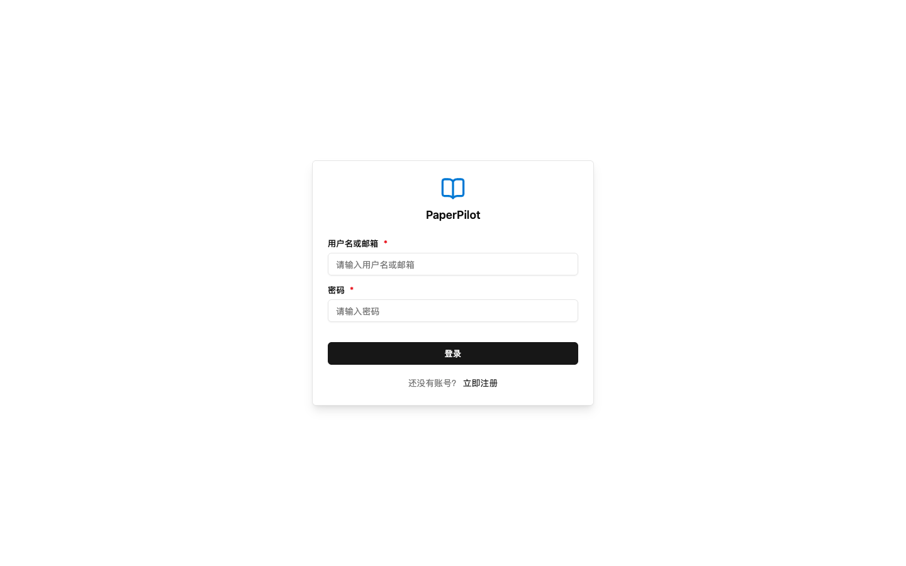

1. 第一次使用时点击登录页下方的“立即注册”，填写用户名、邮箱和密码。用户名 3–50 个字符，密码至少 8 位。
2. 注册成功后回到登录页，用用户名或邮箱登录。登录状态保持 7 天。
3. 点击右上角的退出图标退出登录。

> 注册页目前提示“密码至少 6 个字符”“用户名 3 到 20 个字符”，与实际规则不符，以本手册为准。这是已知缺陷，见[测试报告](06-test-report.md#6-缺陷记录) D-10。

## 4. 学习看板

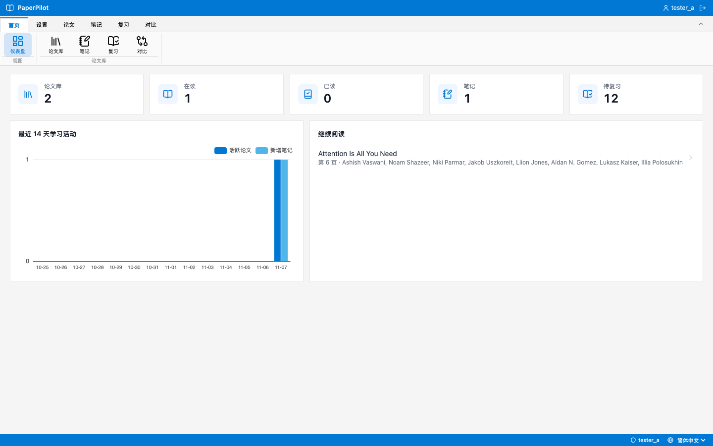

登录后进入首页，可以看到：

- 论文库总数、在读、已读、笔记和待复习的数量；
- 最近 14 天的学习活动：每天活跃的论文数和新增笔记数；
- 继续阅读：最近在读的论文和上次读到的页，点击直接打开。

## 5. 论文库

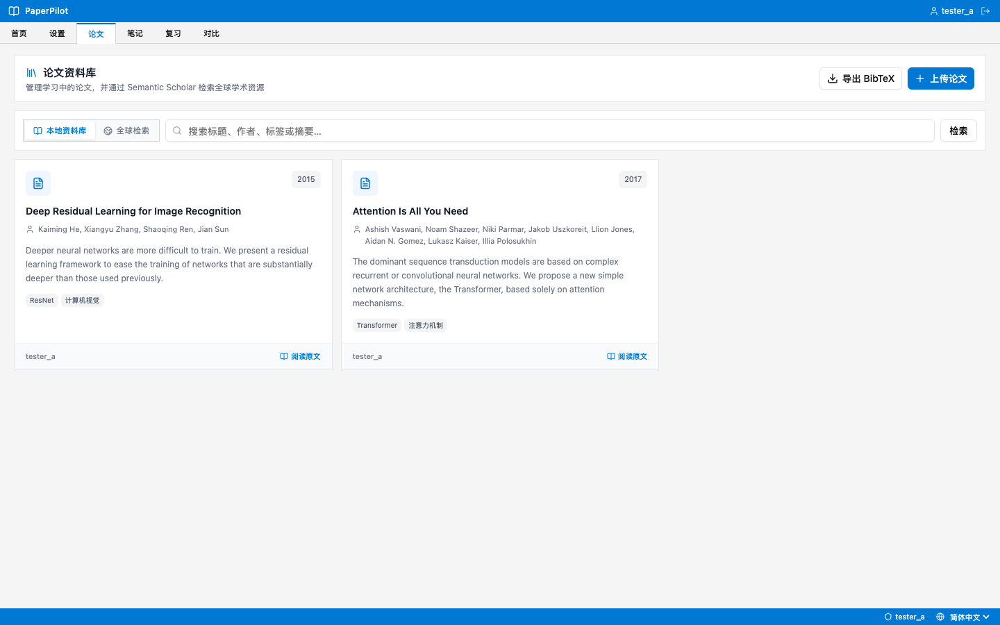

### 5.1 上传论文

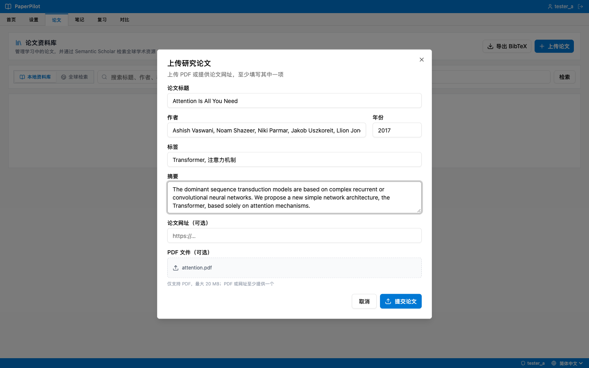

1. 点击右上角“上传论文”。
2. 填写标题、作者和年份。标签用逗号分隔，最多 10 个；摘要选填，没有全文时 AI 会基于摘要回答。
3. 选择 PDF 文件（不超过 20 MB），或者填写论文网址，两者至少提供一项。
4. 点击“提交论文”。

上传 PDF 后，系统在后台解析全文，通常几秒内完成。解析期间打开论文会看到“正在解析全文”的提示，完成后才能使用 AI 问答和导读。

| 解析结果 | 说明 |
| :--- | :--- |
| 全文已解析 | 可以使用全部功能 |
| 没有提取到文字 | 通常是扫描版 PDF，AI 只能基于摘要回答 |
| 全文解析失败 | 文件可能损坏或加密。上传者可以点击“重新解析” |

### 5.2 搜索与在线检索

- **本地资料库**：在搜索框输入关键词，匹配标题、作者、标签和摘要。
- **全球检索**：切换到“全球检索”，输入英文关键词检索 Semantic Scholar，点击“收藏”以外链方式加入论文库。没有配置 `SEMANTIC_SCHOLAR_API_KEY` 时经常被限流，检索失败时请稍后再试。

### 5.3 删除与导出

- 打开论文后，上传者可以点击右上角“删除”。删除后所有用户的相关笔记、高亮和卡片都会一并删除。
- 论文库页面的“导出 BibTeX”导出整个论文库的引用。

## 6. 阅读论文

点击论文卡片上的“阅读原文”，进入详情页：左侧是 PDF 阅读器，右侧是学习面板。

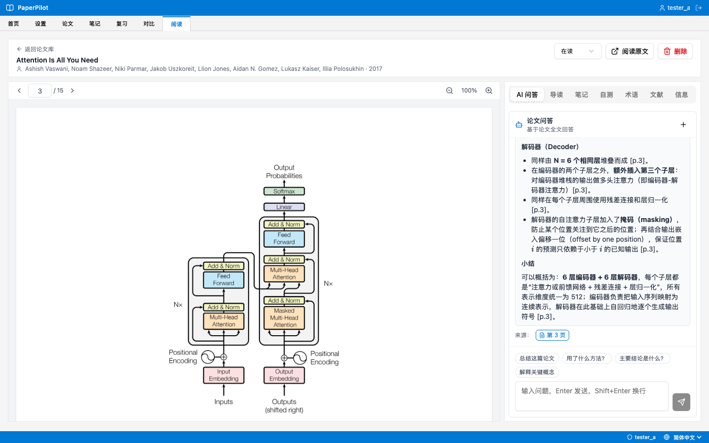

### 6.1 阅读器

- 用左上角的箭头翻页，或在页码框中输入页码后按回车跳转。
- 右上角可以缩小、放大和适合宽度。
- 系统会记住你读到的页，下次打开时自动恢复。
- 页面右上方的下拉框可以把论文标记为未读、在读或已读。翻页时会自动标记为在读。

### 6.2 划词操作

在 PDF 中选中一段文字，松开鼠标后选区上方会出现工具条：

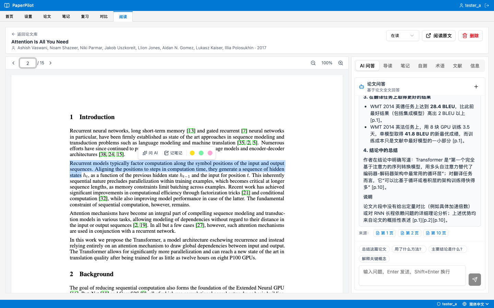

| 按钮 | 作用 |
| :--- | :--- |
| 问 AI | 把“请解释这段话”和选中的原文填入问答输入框，可以修改后再发送。AI 会结合当前页的内容回答 |
| 记笔记 | 把选中的原文引用到笔记输入框，补充想法后点击“添加笔记” |
| 黄 / 绿 / 粉 | 用对应颜色高亮选中的文字 |

### 6.3 高亮

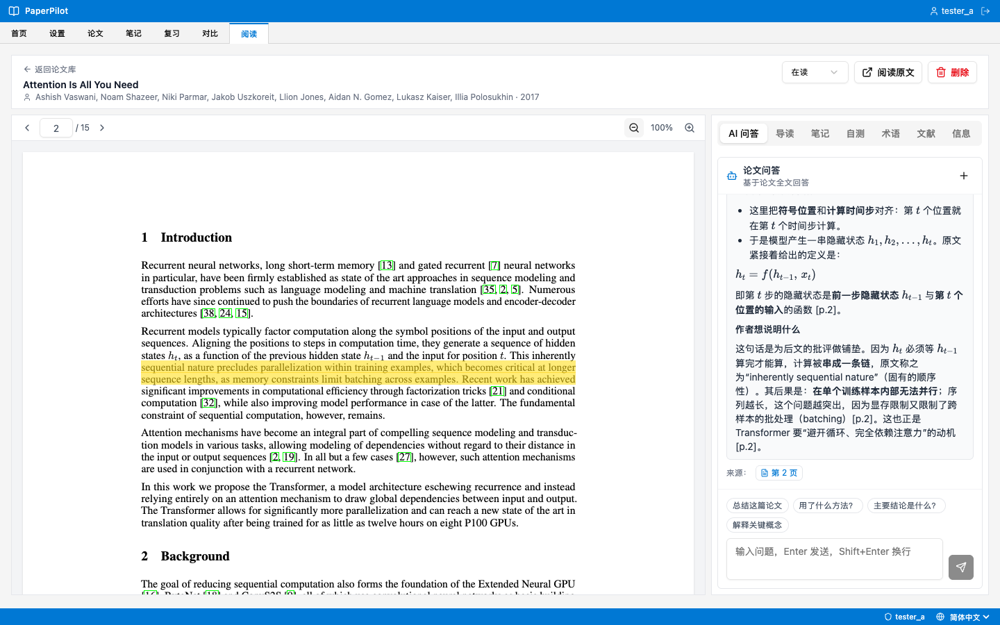

高亮保存在原文的位置，缩放后不会错位。在右侧“笔记”标签中可以看到当前论文的高亮列表，点击页码跳回原文，也可以删除，或点击“转为笔记”。删除笔记时高亮会保留。界面暂时不能修改已有高亮的颜色，需要换颜色时删除后重新高亮。

## 7. AI 学习

右侧学习面板有七个标签：AI 问答、导读、笔记、自测、术语、文献、信息。AI 生成的内容可能有误，请对照原文。

### 7.1 AI 问答

1. 在“AI 问答”标签的输入框中输入问题，按 Enter 发送，Shift + Enter 换行。也可以点击下方的快捷问题。
2. 回答逐字显示，句末的 `[p.3]` 表示内容来自第 3 页。
3. 回答下方的“来源”列出引用的页，点击后阅读器跳到对应页。
4. 可以继续追问，例如“它的缺点呢”。对话会自动保存，刷新页面后恢复；点击面板右上角的加号清空对话记录。

可以用中文提问英文论文，系统会自动转换检索词。只有外链、没有 PDF 的论文，AI 会说明回答仅基于摘要。

### 7.2 导读

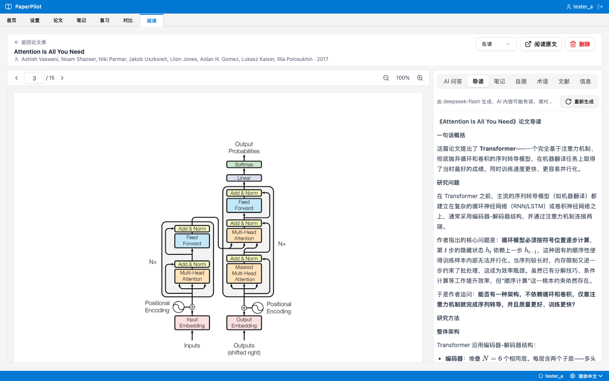

打开“导读”标签，点击“生成导读”。约十几到几十秒后生成一份学习指南，包括一句话概括、研究问题、研究方法、主要结论、关键概念和阅读难点。导读生成后保存下来，其他用户打开同一篇论文时直接看到，不需要重新生成；对结果不满意可以点击“重新生成”。中文界面和英文界面的导读分别生成。

### 7.3 术语表

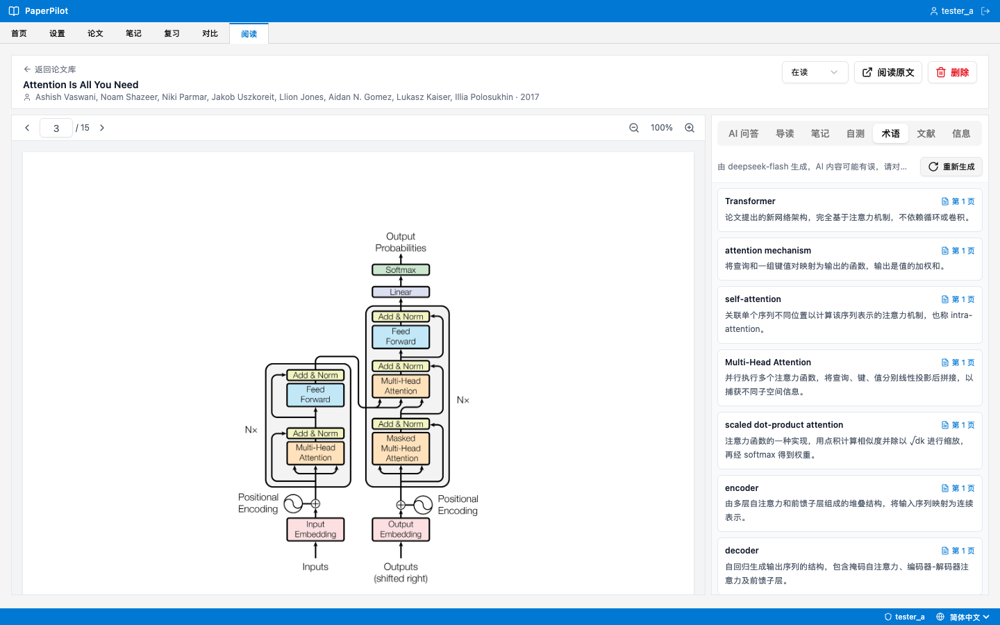

打开“术语”标签，点击“提取术语”，生成最多 15 个关键术语及解释。术语右侧的页码是它在论文中首次出现的位置，点击可以跳转。

### 7.4 自测与闪卡

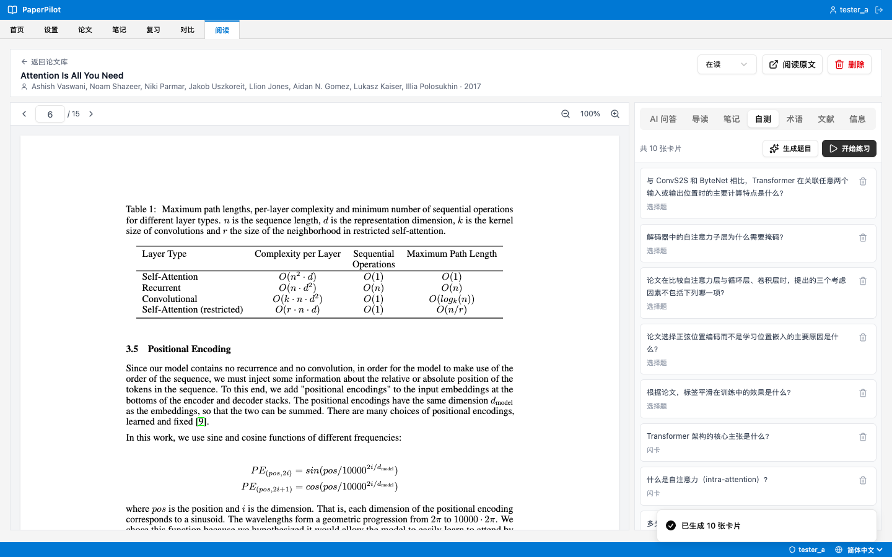

1. 打开“自测”标签，点击“生成题目”，生成 5 道选择题和 5 张闪卡。再次生成会补充新题目，已有的题目不会重复。
2. 点击“开始练习”逐题作答：选择题选中选项后显示对错和解析；闪卡先回想答案，点击“显示答案”后选择“记住了”或“没记住”。
3. 作答结果会进入间隔复习，见第 8 节。

### 7.5 参考文献

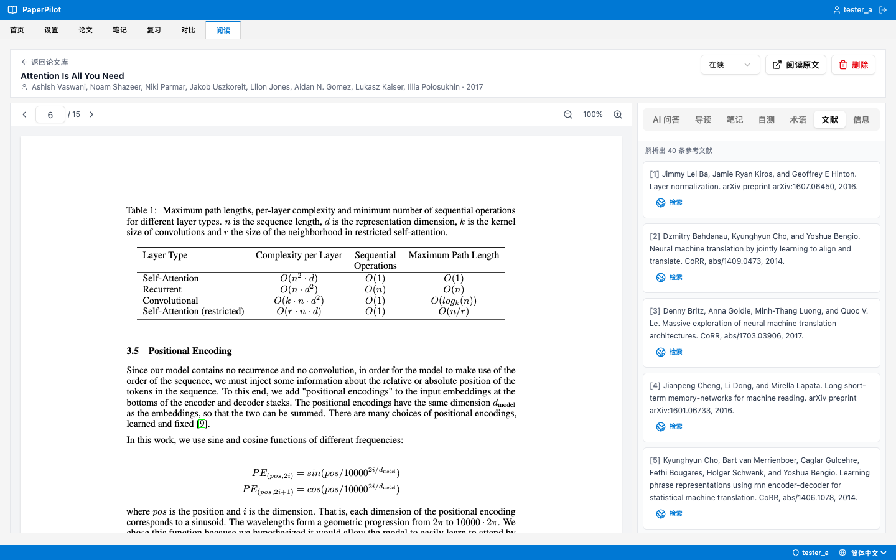

“文献”标签列出从 PDF 中解析出的参考文献。点击某条右侧的“检索”在 Semantic Scholar 中查找这篇论文，找到后可以“加入论文库”。外链论文、扫描版 PDF 或排版特殊的论文可能解析不到。

### 7.6 多论文对比

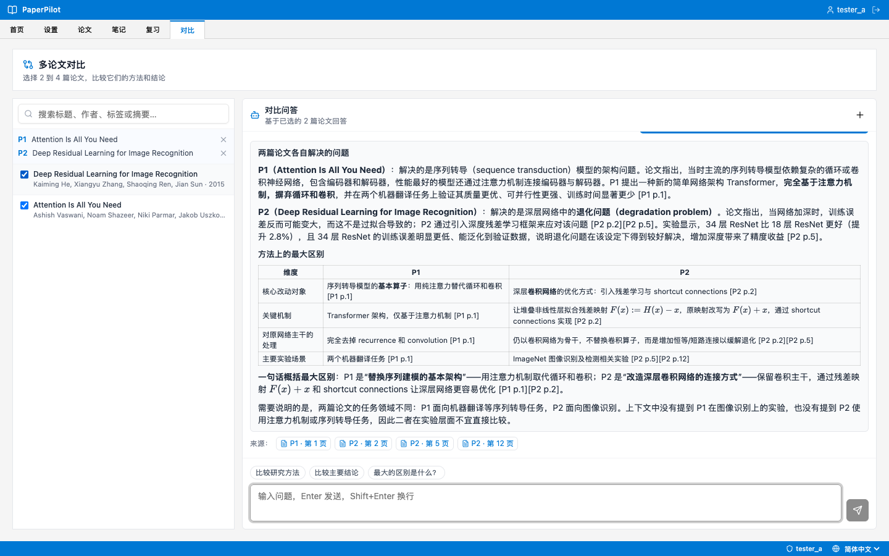

1. 点击顶部的“对比”。
2. 在左侧勾选 2 到 4 篇论文（还在解析的论文不能选）。
3. 在右侧提问，或点击“比较研究方法”“比较主要结论”等快捷问题。
4. 回答中的 `[P1 p.3]` 表示第 1 篇论文的第 3 页，点击下方来源会打开对应论文并跳到该页。

对比问答不保存记录。

## 8. 笔记与复习

### 8.1 在阅读页记笔记

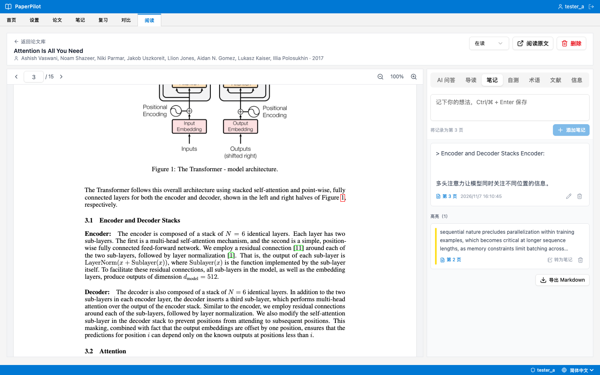

在“笔记”标签中输入内容，按 Ctrl/⌘ + Enter 或点击“添加笔记”保存，笔记会记录当前页码。点击笔记上的页码可以跳回原文，也可以编辑和删除。

### 8.2 我的笔记

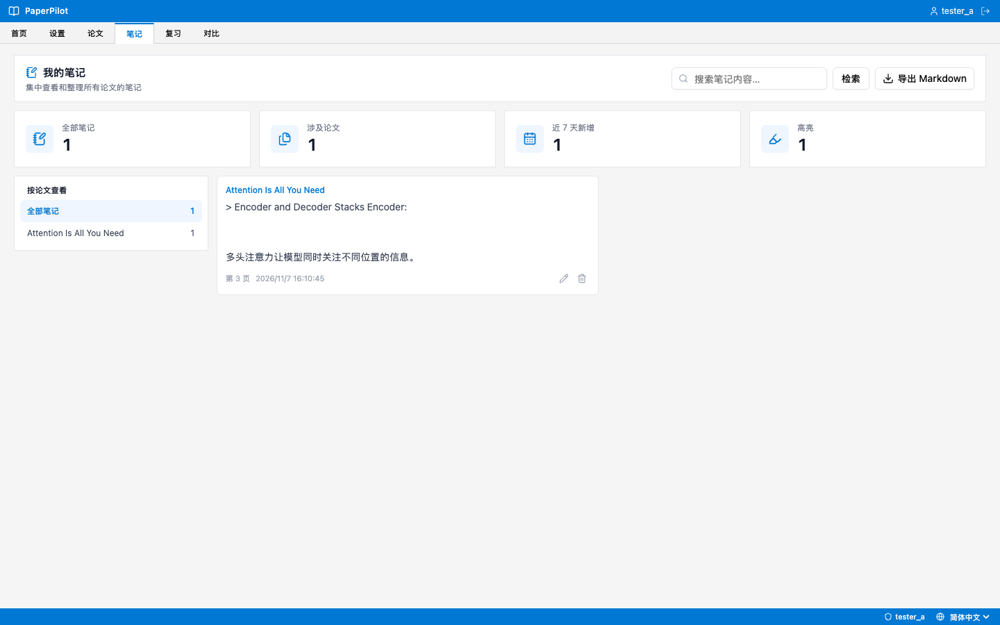

点击顶部的“笔记”，集中查看所有论文的笔记：

- 上方统计全部笔记、涉及论文、近 7 天新增和高亮数量；
- 左侧按论文筛选，右上角搜索笔记内容；
- “导出 Markdown”按论文和页码导出笔记。

### 8.3 间隔复习

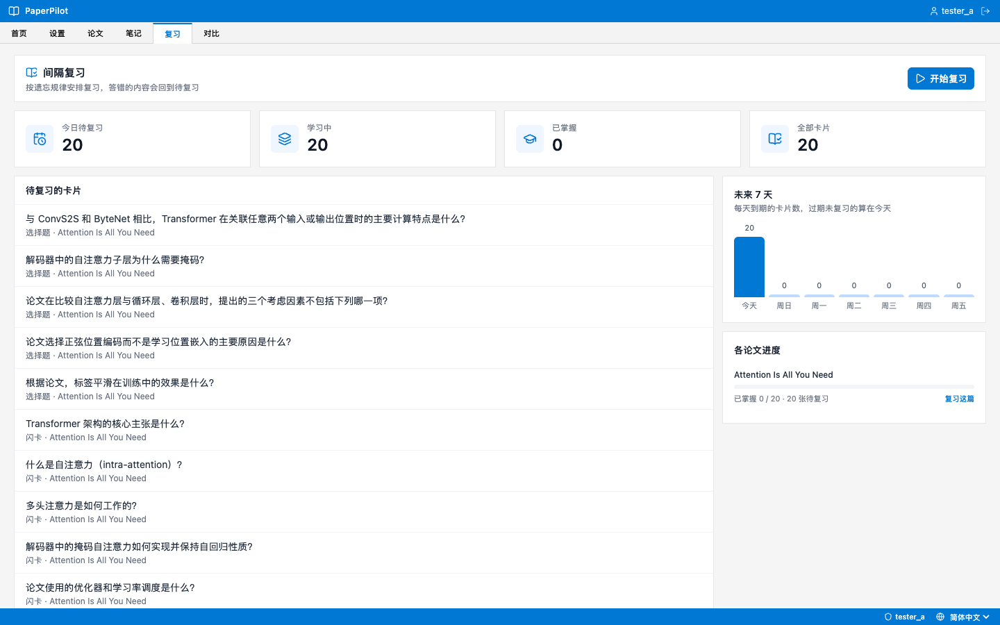

点击顶部的“复习”：

- 上方显示今日待复习、学习中、已掌握和全部卡片的数量；
- 右侧“未来 7 天”显示每天到期的卡片数，“各论文进度”可以只复习某一篇；
- 点击“开始复习”逐张作答。

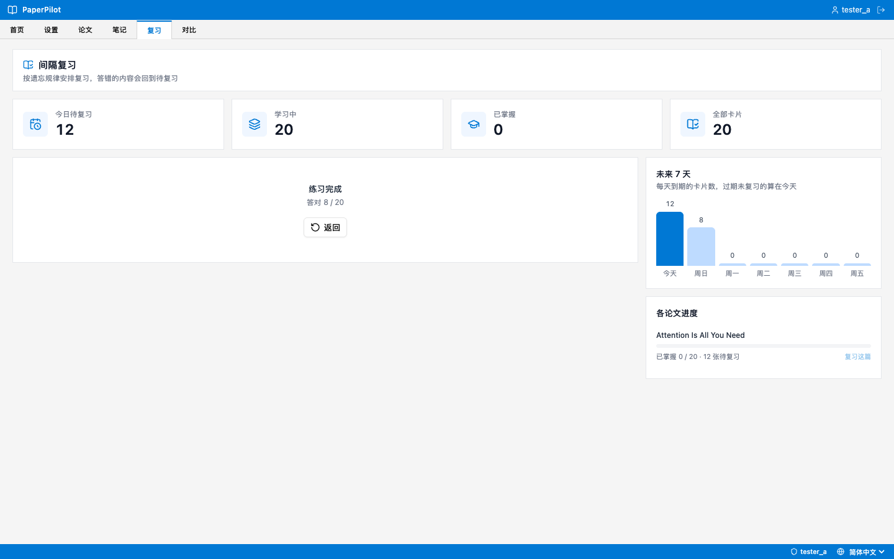

复习规则：答对的卡片分别在 1、3、7、14、30 天后再次出现；答错的卡片立即回到待复习。连续答对 3 次计为已掌握。

## 9. 切换语言

点击右下角状态栏的语言选项，在“简体中文”和“English”之间切换。

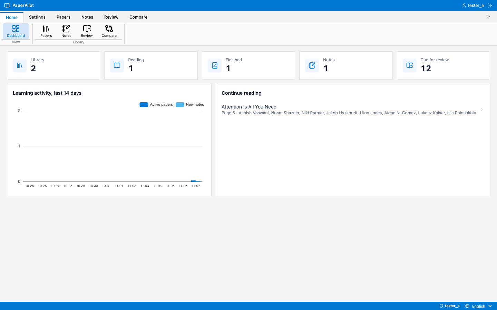

## 10. 常见问题

| 问题 | 解决方法 |
| :--- | :--- |
| AI 面板提示未配置 | 管理员需要在 `.env` 中填写 `AI_OPENAI_MODEL_ID` 和 `AI_OPENAI_API_KEY` 并重启后端 |
| 提示“论文还在解析中” | 等待几秒，解析完成后再试 |
| AI 提示“回答过长被截断” | 把问题拆小后再问 |
| 导读生成失败或不完整 | 点击“重新生成”；使用 DeepSeek 时确认设置了 `AI_OPENAI_REASONING_EFFORT=low` |
| 扫描版 PDF 无法问答 | 系统不做文字识别，AI 只能基于摘要回答；可以换成带文字层的 PDF |
| 在线检索失败 | Semantic Scholar 限流，稍后再试，或配置 `SEMANTIC_SCHOLAR_API_KEY` |
| 上传失败 | 确认文件是 PDF 且不超过 20 MB |
| 删除按钮不可用 | 只有上传者可以删除论文 |
