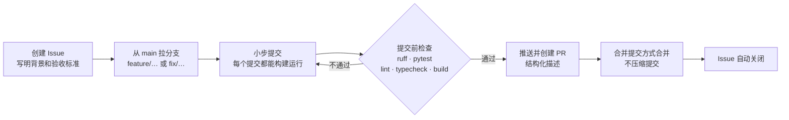

# 开发过程

## 1. 开发模型

项目采用增量迭代的方式开发：先搭好可运行的骨架，再按里程碑逐个加入功能，每个里程碑结束时都是一个可以构建、可以运行的版本。

| 阶段 | 内容 | 对应 PR |
| :--- | :--- | :--- |
| 1. 改造基础 | 删除原项目的仿真模块，用 FastAPI 骨架替换 .NET 后端 | #1、#2 |
| 2. 核心功能 | 认证、论文库、PDF 阅读、全文解析、论文问答、导读、笔记与看板 | #3 – #9 |
| 3. 发布准备 | 品牌、Docker 部署、项目文档 | #10 |
| 4. 功能扩展 | 划词、对话记录、导出、自测与复习、高亮、对比、术语表、参考文献 | #11 – #18 |
| 5. 真实模型适配 | 接入 DeepSeek 后发现并修复 token 上限、截断、公式显示等问题 | #19 |
| 6. 体验改进 | 重做笔记页和复习页 | #20 |
| 7. 缺陷修复 | 划词提问时 AI 找不到选中的文字 | Issue #21 / PR #22 |
| 8. 工程文档 | 本目录下的文档、系统测试和部署验证 | Issue #23 |

## 2. 工作流程



### 2.1 分支

- `main` 是唯一的长期分支，始终保持可运行。
- 功能分支命名为 `feature/简短描述`，缺陷修复为 `fix/简短描述`，合并后删除。
- PR 使用普通合并，不使用 squash，保留每个小步提交。

### 2.2 提交规范

提交标题遵循 Conventional Commits：

| 类型 | 用途 | `main` 上的数量 |
| :--- | :--- | :--- |
| `feat` | 新功能 | 91 |
| `refactor` | 不改变行为的重构，例如删除原项目模块 | 12 |
| `chore` | 依赖、配置等杂项 | 6 |
| `fix` | 缺陷修复 | 5 |
| `docs` | 文档 | 3 |
| `perf` | 性能优化 | 1 |

提交正文分“原因、改动、验证”三部分。以提交 `f9c7dc5` 为例：

```text
feat(chat): 回答完成后保存对话

原因：要恢复对话，得先把问题和回答存下来。

改动：
- chat_events 增加 on_complete 回调，完整回答后才调用，服务层不用关心用户身份
- 模型报错、回答为空时都不保存，避免留下半句话；用户中途停止同样不保存
- 保存时论文已被删除只记日志，不打断已经输出的回答
- 路由提前取出 user_id：流式响应开始后不再依赖请求作用域的 ORM 对象

验证：
- 新增测试：完成后保存问题、回答和引用；模型中途失败不保存；空回答不保存
- ruff、pytest 通过
```

“验证”只写实际运行过的命令和结果；没有验证的内容会明确写出来，例如 Docker 部署在 2026-11-07 之前一直标注为未验证。

### 2.3 提交前检查

| 改动范围 | 必须通过 |
| :--- | :--- |
| 后端 | `ruff check .`、`pytest` |
| 前端 | `npm run lint`、`npm run typecheck`、`npm run build` |
| 数据模型 | 生成 Alembic 迁移，`test_migrations.py` 检查迁移与模型一致 |
| 交互改动 | 在浏览器中走查相关流程，结果写入提交正文 |

### 2.4 PR 描述

PR 使用 `AGENTS.md` 中规定的模板：全量变更概述、核心特性与系统演进、关键修改文件清单、验证结论。

## 3. 里程碑与 PR

| PR | 标题 | 提交数 |
| :--- | :--- | :--- |
| #1 | refactor: 移除仿真模块，保留界面框架 | 10 |
| #2 | feat(backend): 用 FastAPI 骨架替换 .NET 后端 | 7 |
| #3 | feat(auth): 实现注册登录并接入前端 | 12 |
| #4 | feat(papers): 实现论文库后端并接入前端 | 9 |
| #5 | feat(reader): 实现 PDF 阅读器与阅读进度 | 7 |
| #6 | feat(ingest): 解析 PDF 全文并切块 | 8 |
| #7 | feat(ai): 实现基于全文的论文问答与引用跳转 | 6 |
| #8 | feat(guide): 实现 AI 导读 | 6 |
| #9 | feat(notes): 实现笔记、阅读进度和学习看板 | 8 |
| #10 | feat: 完成 PaperPilot 品牌、部署和项目文档 | 4 |
| #11 | feat(reader): 支持划词提问和划词笔记 | 2 |
| #12 | feat(chat): 保存论文对话记录 | 4 |
| #13 | feat(export): 导出笔记和论文引用 | 4 |
| #14 | feat(study): 实现自测题、闪卡和间隔复习 | 8 |
| #15 | feat(highlight): 实现 PDF 高亮批注 | 3 |
| #16 | feat(compare): 实现多论文对比问答 | 2 |
| #17 | feat(glossary): 实现论文术语表 | 3 |
| #18 | feat(references): 解析参考文献并接入论文库 | 3 |
| #19 | fix(ai): 适配真实模型的 token 上限、截断和公式显示 | 4 |
| #20 | feat(ui): 重做笔记页和复习页 | 6 |
| #22 | fix(chat): 把正在读的页放进问答上下文 | 2 |

说明：

- 项目最初在原组织的私有仓库中开发，PR #1 – #10 当时就以 PR 形式合并。迁到本仓库后，为了保留审查记录，在 2026-11-01 用当时的提交重新创建了 PR #1 – #20，每个 PR 都标明“补录”。PR 的创建时间是补录当天，其中的提交保留原始时间。
- #11 – #20 当时直接在集成分支上提交，没有开 PR，同样是补录。
- 从 Issue #21 起，所有改动都走真实的 Issue → 分支 → PR 流程。

## 4. 统计

截至文档编写时，`main` 分支上本项目的非合并提交共 118 个，修改 492 个文件，新增 16185 行、删除 19100 行。删除多于新增，是因为第一阶段移除了原项目的仿真模块和 .NET 后端。

提交时间分布（UTC-8）：

| 日期 | 提交数 | 内容 |
| :--- | :--- | :--- |
| 2026-11-01 | 118 | 全部功能开发、真实模型适配、缺陷修复 |
| 2026-11-06 – 11-07 | 本次文档分支 | 工程文档、系统测试、部署验证 |

## 5. 工具

| 用途 | 工具 |
| :--- | :--- |
| 版本控制与协作 | Git、GitHub Issues / Pull Requests、gh 命令行 |
| 后端质量 | ruff、pytest、pytest-cov |
| 前端质量 | rslint、TypeScript、Prettier |
| 构建 | Rsbuild、Alembic |
| 系统测试 | Playwright（驱动 Chrome） |
| 部署 | Docker Compose、nginx |

## 6. 配置管理与安全

- 密钥只放在 `paper-backend/.env` 和 `docker/.env` 中，两者都被 git 忽略；仓库中只提交 `.env.example` 模板。
- `JWT_KEY` 没有默认值，缺失或过短时服务拒绝启动，避免用公开的默认密钥签发登录凭证。
- 仓库公开前检查了完整的提交历史，移除了原项目遗留的配置文件和部署脚本。
- 数据库结构只通过 Alembic 迁移修改，迁移文件随代码一起提交。

## 7. 风险与应对

| 风险 | 实际情况 | 应对 |
| :--- | :--- | :--- |
| 大模型行为与测试替身不一致 | 接入 DeepSeek 后才发现推理过程占用 token、改写提示词被当作问题回答等问题，替身完全暴露不了 | 关键流程用真实模型复测；截断和非法输出都按失败处理，不保存残缺结果 |
| AI 编造内容 | 模型可能给出不存在的页码 | 来源页只能来自检索结果，术语页码由服务端查找，卡片页码必须在上下文中出现 |
| 删除原项目模块导致白屏 | 原前端多处在启动时调用仿真接口 | 先解除耦合再逐个删除模块，每一步都运行类型检查和构建 |
| 外部服务不可用 | Semantic Scholar 无 Key 时频繁 429 | 后端有限次重试后返回明确的错误提示；配置项支持填写 API Key |
| 密钥泄露 | 原项目历史中有配置文件 | 公开前清理历史；新代码只从环境变量读取密钥 |

## 8. 总结与反思

**做得好的地方**

- 每个提交都能构建运行，提交正文记录了原因和验证结果，出问题时能快速定位到具体提交。
- 后端测试覆盖率 98%，大模型和外部服务用替身代替，失败、截断、限流等情况都能稳定复现。
- AI 回答的可信度放在设计的核心位置：页码可追溯、防提示词注入、只保存完整结果。

**不足和改进方向**

- 测试替身让单元测试稳定，却掩盖了真实模型的问题。应该更早接入真实模型做端到端测试。
- 前端没有自动化单元测试，主要依靠类型检查和浏览器走查。系统测试脚本也还没有纳入仓库。
- 清理翻译 key 的脚本有盲区，导致误删（缺陷 D-01）；改过规则后提示文字没有同步（缺陷 D-10）。改动规则时应该同时检查所有相关的文案和文档。
- 提交集中在同一天，阶段之间缺少时间间隔；工程文档是在功能完成后才补写的，更好的做法是需求和设计文档先行，随开发同步更新。
- Semantic Scholar 的真实检索一直没能验证。
